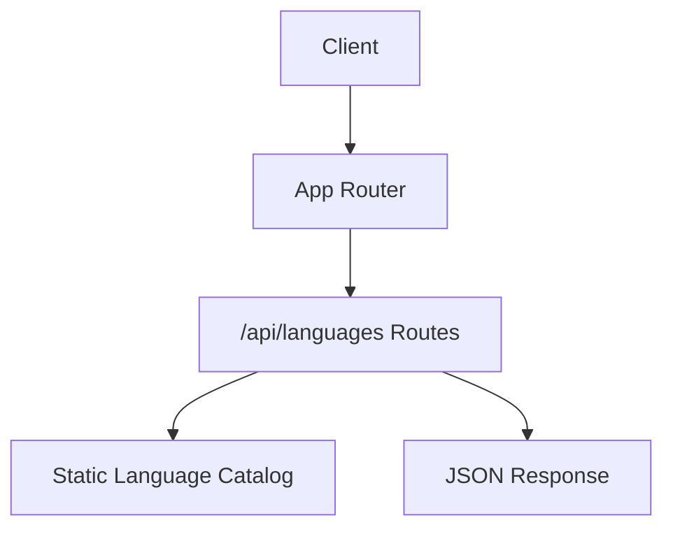
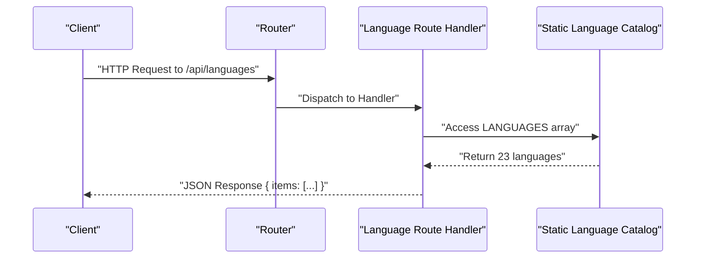
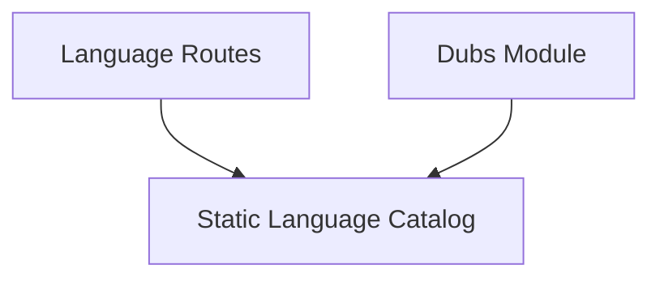

# Language Management Endpoints

<cite>
**Referenced Files in This Document**
- [languages.ts](file://src/routes/languages.ts)
- [languages.ts](file://src/lib/languages.ts)
- [index.ts](file://src/index.ts)
- [dubs.ts](file://src/lib/dubs.ts)
- [languages.test.ts](file://test/languages.test.ts)
</cite>

## Update Summary
**Changes Made**
- Updated endpoint documentation to reflect actual static GET-only implementation
- Removed non-existent CRUD operation documentation (POST, PUT, DELETE)
- Corrected authentication requirements (endpoint is public, not authenticated)
- Updated language count from generic to specific 23 languages including Chinese
- Added accurate request/response schemas based on actual implementation
- Removed database schema references as languages are statically defined

## Table of Contents
1. [Introduction](#introduction)
2. [Project Structure](#project-structure)
3. [Core Components](#core-components)
4. [Architecture Overview](#architecture-overview)
5. [Detailed Component Analysis](#detailed-component-analysis)
6. [Dependency Analysis](#dependency-analysis)
7. [Performance Considerations](#performance-considerations)
8. [Troubleshooting Guide](#troubleshooting-guide)
9. [Conclusion](#conclusion)
10. [Appendices](#appendices)

## Introduction
This document provides comprehensive API documentation for the language management endpoints that serve the static catalog of supported languages and their configuration. The endpoint exposes the complete list of 23 supported languages including Chinese (`zh`), which mirrors the translation coverage baked into the Trackdub desktop app. Unlike typical CRUD APIs, this endpoint is read-only and public, enabling frontend components like dropdowns and sign-up forms to populate language options without requiring authentication.

## Project Structure
The language management feature is implemented as a minimal route module with a static language catalog:
- Route handler for `/api/languages` returns the static language array
- Language constants are centralized in a library module
- The application entry point wires up the route
- Tests verify the presence of all 23 languages including Chinese

**Diagram sources**
- [index.ts](file://src/index.ts)
- [languages.ts](file://src/routes/languages.ts)
- [languages.ts](file://src/lib/languages.ts)

**Section sources**
- [index.ts](file://src/index.ts)
- [languages.ts](file://src/routes/languages.ts)
- [languages.ts](file://src/lib/languages.ts)

## Core Components
- Route Handler: Simple GET endpoint that returns the static language catalog
- Static Language Catalog: Immutable array of 23 supported languages with codes and names
- Application Router: Wires up the languages route under `/api/languages`
- Integration: Used by other modules like dubs for language validation

**Section sources**
- [languages.ts](file://src/routes/languages.ts)
- [languages.ts](file://src/lib/languages.ts)
- [dubs.ts](file://src/lib/dubs.ts)

## Architecture Overview
The language management API follows a simple, static architecture:
- Client requests enter through the application router
- Route handlers return static data directly without authentication or validation
- Language data is served from an in-memory constant array
- No database interactions or complex business logic involved

**Diagram sources**
- [index.ts](file://src/index.ts)
- [languages.ts](file://src/routes/languages.ts)
- [languages.ts](file://src/lib/languages.ts)

## Detailed Component Analysis

### Endpoint: List Languages (GET /api/languages)
- Purpose: Retrieve the static catalog of 23 supported languages
- Authentication: **Not required** - endpoint is public for dropdown population
- Authorization: None - accessible to all clients
- Query Parameters: None
- Response Schema:
  - Object with `items` property containing array of language objects
  - Each language object has: `code` (string), `name` (string)
- Example curl:
  - curl -X GET "https://your-domain/api/languages"
- Example JavaScript fetch:
  - fetch("/api/languages").then(r => r.json()).then(console.log)

**Updated** The endpoint is now documented as public and read-only, matching the actual implementation.

**Section sources**
- [languages.ts:8-14](file://src/routes/languages.ts#L8-L14)
- [languages.ts:24-41](file://src/lib/languages.ts#L24-L41)

### Supported Languages Catalog
The API serves exactly 23 supported languages, including the recently added Chinese (`zh`):

| Code | Name | Notes |
|------|------|-------|
| ar | Arabic | |
| da | Danish | |
| de | German | |
| el | Greek | |
| en | English | |
| es | Spanish | |
| fi | Finnish | |
| fr | French | |
| he | Hebrew | |
| hi | Hindi | |
| it | Italian | |
| ja | Japanese | |
| ko | Korean | |
| ms | Malay | |
| nl | Dutch | |
| no | Norwegian | |
| pl | Polish | |
| pt | Portuguese | |
| ru | Russian | |
| sv | Swedish | |
| sw | Swahili | |
| tr | Turkish | |
| zh | Chinese | Qwen3 CustomVoice Mandarin presets |

**Updated** Added Chinese (`zh`) as the 23rd language, mirroring the desktop engine's TranslationLanguageCoverageMatrix.

**Section sources**
- [languages.ts:24-41](file://src/lib/languages.ts#L24-L41)

### Internationalization Best Practices
- Locale Validation:
  - Use BCP-47 compliant language codes (ISO 639-1)
  - Validate against the static catalog for known languages
- Multi-Language Content Management:
  - Store localized strings separately from business data
  - Maintain mapping between resource IDs and language-specific translations
- Default Fallbacks:
  - Implement fallback mechanisms to default language when translations missing
- Consistency:
  - Ensure consistent naming conventions for locale keys and file structures

[No sources needed since this section provides general guidance]

### Caching Strategies for Language Data
- In-Memory Cache:
  - Language catalog is already cached in memory as a constant array
- CDN Edge Caching:
  - Serve static language assets via CDN for low-latency global access
- Browser Caching:
  - Set appropriate cache-control headers for language resources
- Versioning:
  - Version language bundles to avoid stale content issues

[No sources needed since this section provides general guidance]

## Dependency Analysis
The language management endpoints have minimal dependencies:
- Route handler imports the static language catalog
- Other modules use the catalog for language validation
- No external services or database connections required

**Diagram sources**
- [languages.ts](file://src/routes/languages.ts)
- [languages.ts](file://src/lib/languages.ts)
- [dubs.ts](file://src/lib/dubs.ts)

**Section sources**
- [languages.ts](file://src/routes/languages.ts)
- [languages.ts](file://src/lib/languages.ts)
- [dubs.ts](file://src/lib/dubs.ts)

## Performance Considerations
- Zero Database Queries:
  - Static data eliminates database overhead entirely
- Minimal Memory Footprint:
  - Small constant array with 23 language entries
- Fast Response Times:
  - Direct array access without processing overhead
- CDN Optimization:
  - Static JSON responses are ideal for CDN caching

[No sources needed since this section provides general guidance]

## Troubleshooting Guide
Common issues and resolutions:
- Empty Response:
  - Verify the endpoint path is correct: `/api/languages`
- Missing Chinese Language:
  - Check if using updated version with 23-language catalog
- CORS Issues:
  - Ensure proper origin configuration in environment variables
- Integration Problems:
  - Verify language code validation against the static catalog

**Section sources**
- [languages.test.ts:5-23](file://test/languages.test.ts#L5-L23)

## Conclusion
The language management endpoints provide a simple, efficient way to access the static catalog of 23 supported languages. With Chinese (`zh`) now included as the 23rd language, the API fully mirrors the desktop engine's translation coverage. The read-only, public nature of the endpoint makes it ideal for frontend components that need to populate language selection interfaces without authentication overhead.

[No sources needed since this section summarizes without analyzing specific files]

## Appendices

### Request/Response Schemas Summary
- List Languages Response:
  - Object with `items` property containing array of language objects
  - Each language object: `{ code: string, name: string }`
- Status Codes:
  - 200: Success response with language catalog
  - 404: Not found (route doesn't exist)

**Section sources**
- [languages.ts:12-14](file://src/routes/languages.ts#L12-L14)

### Error Handling Patterns
- Not Found:
  - 404 status for invalid routes
- CORS Errors:
  - Origin validation failures handled by middleware

**Section sources**
- [index.ts:14-33](file://src/index.ts#L14-L33)