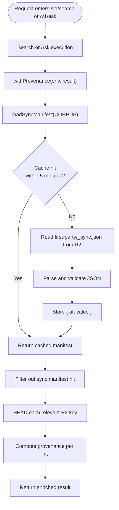
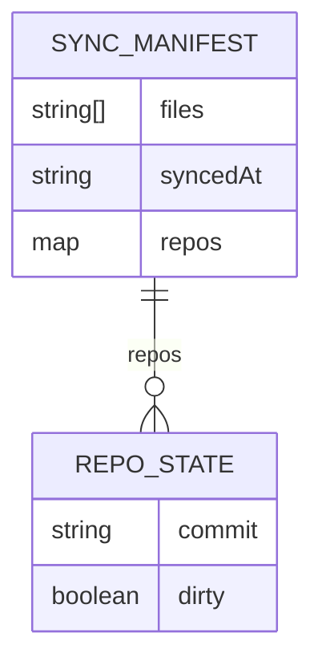
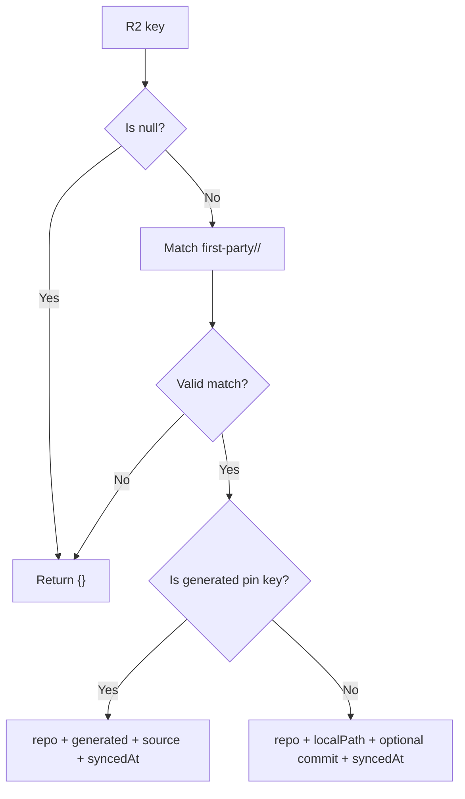
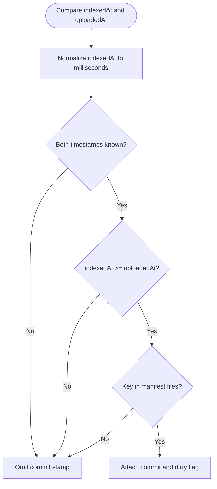
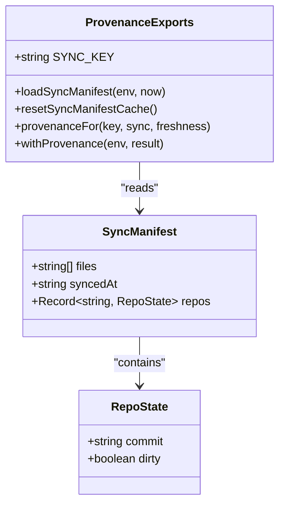
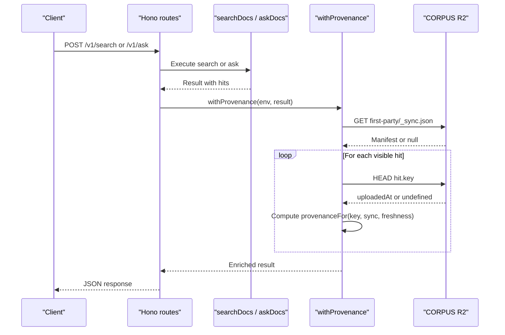
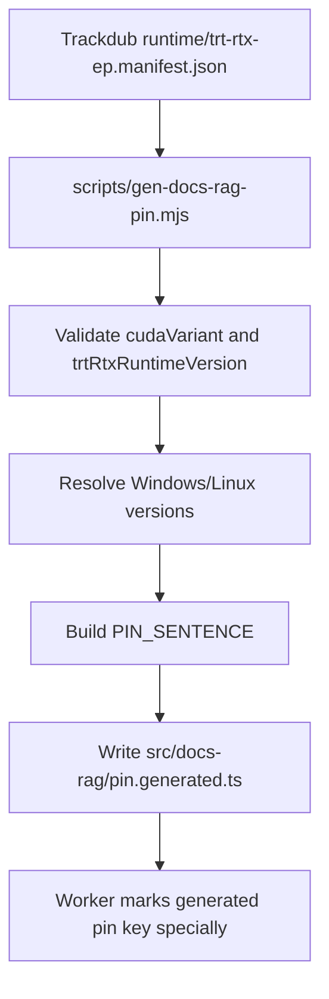
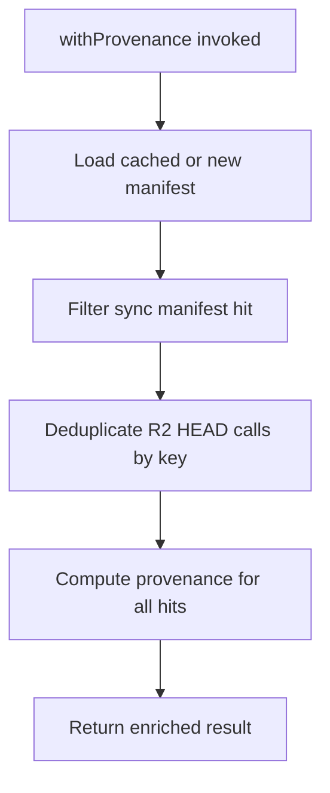
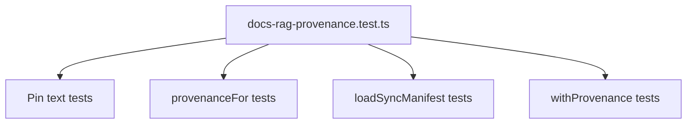

# Docs RAG Provenance System

<cite>
**Referenced Files in This Document**
- [provenance.ts](file://src/docs-rag/provenance.ts)
- [types.ts](file://src/docs-rag/types.ts)
- [index.ts](file://src/docs-rag/index.ts)
- [pin.generated.ts](file://src/docs-rag/pin.generated.ts)
- [gen-docs-rag-pin.mjs](file://scripts/gen-docs-rag-pin.mjs)
- [docs-rag-provenance.test.ts](file://test/docs-rag-provenance.test.ts)
</cite>

## Table of Contents
1. [Introduction](#introduction)
2. [Purpose and Scope](#purpose-and-scope)
3. [Module Structure](#module-structure)
4. [Sync Manifest Contract](#sync-manifest-contract)
5. [Key-to-Repository Mapping](#key-to-repository-mapping)
6. [Freshness Semantics](#freshness-semantics)
7. [Public API Surface](#public-api-surface)
8. [Request Flow with Provenance](#request-flow-with-provenance)
9. [Generated Pin Reference](#generated-pin-reference)
10. [Error Handling and Degradation](#error-handling-and-degradation)
11. [Performance Characteristics](#performance-characteristics)
12. [Testing Coverage](#testing-coverage)
13. [Operational Notes](#operational-notes)
14. [Conclusion](#conclusion)

## Introduction
The Docs RAG provenance system is a focused addition to the Trackdub docs-rag Worker that attaches source-of-trust metadata to search and ask results. It does not implement document synchronization, indexing, or storage itself. Instead, it interprets an externally staged sync manifest from Cloudflare R2, maps R2 object keys to Trackdub repository names and local checkout paths, determines whether indexed content is fresh relative to its R2 upload time, and augments result hits with commit provenance where available.

This module is consumed by the existing `/v1/search` and `/v1/ask` routes so clients receive enriched hit objects without changing the upstream search implementation.

## Purpose and Scope
- Load the sync manifest (`first-party/_sync.json`) from the `CORPUS` R2 bucket.
- Map R2 keys such as `first-party/<repo>/<path>` to `{ repo, localPath }`.
- Mark the generated pin document differently from normal checkout files.
- Compare AI Search `indexedAt` timestamps against R2 `uploadedAt` timestamps to decide whether a commit stamp is trustworthy.
- Attach provenance fields to every visible search hit.
- Degrade gracefully when the manifest, JSON, R2 access, or timestamp data is missing or malformed.

Out of scope:
- Writing or maintaining the sync manifest.
- Implementing AI Search, Vectorize, MCP routing, authentication, rate limiting, or CORS.
- Managing secrets or environment configuration beyond the `DocsRagBindings` shape used by this module.

**Section sources**
- [provenance.ts:1-125](file://src/docs-rag/provenance.ts#L1-L125)
- [index.ts:1-90](file://src/docs-rag/index.ts#L1-L90)

## Module Structure
The provenance module is organized around three responsibilities:

| Responsibility | Implementation |
|---|---|
| Manifest loading and caching | `loadSyncManifest`, `SYNC_KEY`, `CACHE_TTL_MS`, module-level cache |
| Stamp computation | `provenanceFor`, `stampFor`, `indexedCurrent`, `commitFields`, `syncedAtField` |
| Result enrichment | `withProvenance`, `objectUploadedAt`, `parseFirstPartyKey` |

**Diagram sources**
- [index.ts:42-89](file://src/docs-rag/index.ts#L42-L89)
- [provenance.ts:25-125](file://src/docs-rag/provenance.ts#L25-L125)

**Section sources**
- [provenance.ts:1-125](file://src/docs-rag/provenance.ts#L1-L125)
- [index.ts:1-90](file://src/docs-rag/index.ts#L1-L90)

## Sync Manifest Contract
The sync manifest describes which R2 objects came from which Trackdub repositories and when the sync ran. Its type is intentionally tolerant: missing fields are treated as absent rather than fatal.

| Field | Type | Meaning |
|---|---|---|
| `files` | Optional string array | Every R2 key staged by the sync tool; membership is required before attaching a commit stamp |
| `syncedAt` | Optional ISO-like string | Timestamp of the sync operation; attached to every mapped result |
| `repos` | Optional record keyed by repository name | Per-repo state including `commit` and `dirty` |

The module rejects non-object values for the parsed manifest, treats malformed arrays as no membership, and ignores empty strings for `syncedAt`.

**Diagram sources**
- [provenance.ts:11-23](file://src/docs-rag/provenance.ts#L11-L23)

**Section sources**
- [provenance.ts:11-23](file://src/docs-rag/provenance.ts#L11-L23)
- [docs-rag-provenance.test.ts:1-100](file://test/docs-rag-provenance.test.ts#L1-L100)

## Key-to-Repository Mapping
Keys are interpreted as follows:

| Input key pattern | Output |
|---|---|
| `first-party/<repo>/<path>` | `{ repo, localPath }` plus optional commit and sync metadata |
| `first-party/trackdub/docs/reference/docs-rag-pin.md` | Generated pin marker instead of a checkout path |
| Any other key or `null` | Empty provenance object |

The generator pins the generated markdown file at `first-party/trackdub/docs/reference/docs-rag-pin.md`; the worker must use the same literal so the special handling matches exactly.

**Diagram sources**
- [provenance.ts:57-89](file://src/docs-rag/provenance.ts#L57-L89)

**Section sources**
- [provenance.ts:57-89](file://src/docs-rag/provenance.ts#L57-L89)
- [pin.generated.ts:1-9](file://src/docs-rag/pin.generated.ts#L1-L9)

## Freshness Semantics
A commit stamp is attached only when two conditions hold:

1. The key appears in the sync manifest’s `files` list.
2. The index reflects the current bytes of the R2 object.

Freshness is computed by comparing `indexedAt` and `uploadedAt`:

- `indexedAt` may be seconds or milliseconds because different indexes report different units.
- If `indexedAt` is less than `1e12`, it is converted to milliseconds.
- The stamp is trusted only when `indexedAt >= uploadedAt`.
- If either timestamp is unknown, the stamp is omitted.
- A retained but deleted-or-retained R2 object can still exist; membership in `files` protects against attributing a commit to stale retained content.

**Diagram sources**
- [provenance.ts:41-55](file://src/docs-rag/provenance.ts#L41-L55)
- [provenance.ts:91-100](file://src/docs-rag/provenance.ts#L91-L100)

**Section sources**
- [provenance.ts:41-55](file://src/docs-rag/provenance.ts#L41-L55)
- [provenance.ts:91-100](file://src/docs-rag/provenance.ts#L91-L100)
- [docs-rag-provenance.test.ts:100-200](file://test/docs-rag-provenance.test.ts#L100-L200)

## Public API Surface
The module exposes four primary exports and one reset helper:

| Export | Parameters | Returns | Purpose |
|---|---|---|---|
| `SYNC_KEY` | None | String constant | Canonical R2 key for the sync manifest |
| `loadSyncManifest` | Environment with `CORPUS`, optional `now` | Promise resolving to manifest or `null` | Loads and caches the manifest |
| `resetSyncManifestCache` | None | `void` | Clears the in-memory manifest cache |
| `provenanceFor` | R2 key, manifest, freshness map | Object | Computes provenance for a single key |
| `withProvenance` | Environment with `CORPUS`, search result | Promise with enriched result | Attaches provenance to all visible hits |

**Diagram sources**
- [provenance.ts:11-125](file://src/docs-rag/provenance.ts#L11-L125)

**Section sources**
- [provenance.ts:11-125](file://src/docs-rag/provenance.ts#L11-L125)

## Request Flow with Provenance
The `/v1/search` and `/v1/ask` routes delegate search execution to the query layer and then wrap the result through `withProvenance`. This keeps authentication, authorization, rate limiting, error mapping, and MCP handling separate from provenance logic.

**Diagram sources**
- [index.ts:42-89](file://src/docs-rag/index.ts#L42-L89)
- [provenance.ts:102-125](file://src/docs-rag/provenance.ts#L102-L125)

**Section sources**
- [index.ts:42-89](file://src/docs-rag/index.ts#L42-L89)
- [provenance.ts:102-125](file://src/docs-rag/provenance.ts#L102-L125)

## Generated Pin Reference
The generated pin constants come from Trackdub’s runtime TensorRT-RTX EP manifest and are regenerated into `src/docs-rag/pin.generated.ts`. The generation script reads `runtime/trt-rtx-ep.manifest.json`, validates required fields, resolves platform versions, and writes a TypeScript module exporting `PIN` and `PIN_SENTENCE`.

Key points:
- The generated pin documents are marked as `generated` rather than ordinary checkout files.
- The `source` field points back to the manifest driving generation.
- The sync tool stages this file at the same path the worker expects, so the special case applies consistently.
- The generator supports both writing the file and checking whether it is up to date.

**Diagram sources**
- [gen-docs-rag-pin.mjs:1-68](file://scripts/gen-docs-rag-pin.mjs#L1-L68)
- [pin.generated.ts:1-9](file://src/docs-rag/pin.generated.ts#L1-L9)
- [provenance.ts:6-8](file://src/docs-rag/provenance.ts#L6-L8)

**Section sources**
- [gen-docs-rag-pin.mjs:1-68](file://scripts/gen-docs-rag-pin.mjs#L1-L68)
- [pin.generated.ts:1-9](file://src/docs-rag/pin.generated.ts#L1-L9)
- [provenance.ts:6-8](file://src/docs-rag/provenance.ts#L6-L8)

## Error Handling and Degradation
The provenance system is designed to fail safely:

| Failure mode | Behavior |
|---|---|
| Missing `_sync.json` object | Manifest becomes `null`; no commit stamps are attached |
| Invalid JSON | Manifest becomes `null` |
| Non-object JSON value | Manifest becomes `null` |
| R2 read throws | Manifest becomes `null` |
| Missing R2 head response | `uploadedAt` becomes `undefined`; stamp is omitted |
| Malformed `files`, `commit`, `dirty`, or `syncedAt` | Fields are ignored rather than exposed or thrown |
| Unknown key or `null` key | Returns empty provenance |
| Stale index timestamp | Returns repo and path without commit stamp |

The design ensures that missing provenance never fails a search or ask request. Clients should treat absence of `syncedCommit` as “no usable provenance,” not as a search failure.

**Section sources**
- [provenance.ts:25-40](file://src/docs-rag/provenance.ts#L25-L40)
- [provenance.ts:41-55](file://src/docs-rag/provenance.ts#L41-L55)
- [provenance.ts:102-125](file://src/docs-rag/provenance.ts#L102-L125)
- [docs-rag-provenance.test.ts:130-200](file://test/docs-rag-provenance.test.ts#L130-L200)

## Performance Characteristics
- **Manifest cache:** The sync manifest is cached in memory for five minutes using a simple `{ at, value }` structure. Subsequent calls within the window skip R2 entirely.
- **Lazy upload checks:** `withProvenance` computes `HEAD` requests only for keys that pass the `first-party` parser.
- **Deduplicated uploads:** Each R2 key is requested once per call through an internal `Map` keyed by key.
- **Parallel enrichment:** Hit provenance is computed concurrently with `Promise.all`.
- **Sync manifest filtering:** The sync manifest hit itself is removed from visible results.

Complexity highlights:
- Manifest load is O(1) after parsing, bounded by cache TTL.
- Provenance computation per hit is dominated by the R2 `HEAD` call.
- Total work is O(h) for h visible first-party hits, with parallel I/O.

**Diagram sources**
- [provenance.ts:25-40](file://src/docs-rag/provenance.ts#L25-L40)
- [provenance.ts:102-125](file://src/docs-rag/provenance.ts#L102-L125)

**Section sources**
- [provenance.ts:25-40](file://src/docs-rag/provenance.ts#L25-L40)
- [provenance.ts:102-125](file://src/docs-rag/provenance.ts#L102-L125)

## Testing Coverage
The test suite verifies the most important behaviors:

- Generated pin sentence presence in the system prompt.
- Commit attachment when indexed content is fresh.
- Dirty-tree flag propagation.
- Generated pin document identification.
- Tolerance for malformed manifest structures.
- Membership requirement via `files`.
- Retained-but-unstaged object behavior.
- Staleness semantics across second and millisecond timestamps.
- Repository/path extraction without a manifest.
- Vendor and null-key handling.
- Manifest cache lifetime and refetch boundary.
- R2 failure degradation.
- End-to-end `withProvenance` enrichment and sync manifest filtering.

**Diagram sources**
- [docs-rag-provenance.test.ts:1-200](file://test/docs-rag-provenance.test.ts#L1-L200)

**Section sources**
- [docs-rag-provenance.test.ts:1-200](file://test/docs-rag-provenance.test.ts#L1-L200)

## Operational Notes
- The `CORPUS` binding must expose the R2 bucket containing the sync manifest under `first-party/_sync.json`.
- The sync tool is responsible for staging the manifest and any pinned documentation at the expected paths.
- Workers using this module should call `resetSyncManifestCache()` only if they explicitly need to force reload outside the five-minute TTL; normal usage relies on automatic caching.
- Consumers should inspect returned provenance fields rather than assuming `syncedCommit` is always present.
- Changes to the generated pin path require coordinated updates between the sync tool and the worker’s `GENERATED_PIN_KEY` constant.

**Section sources**
- [provenance.ts:6-8](file://src/docs-rag/provenance.ts#L6-L8)
- [provenance.ts:25-40](file://src/docs-rag/provenance.ts#L25-L40)
- [types.ts:1-113](file://src/docs-rag/types.ts#L1-L113)

## Conclusion
The provenance module provides a thin, resilient bridge between external corpus synchronization and client-visible search results. By combining a staged manifest, R2 upload timestamps, and strict key interpretation, it tells consumers whether a hit corresponds to a known commit, whether that commit came from a dirty tree, and when the sync occurred. Its failure-first design guarantees that missing or corrupted provenance data degrades silently while preserving search functionality.