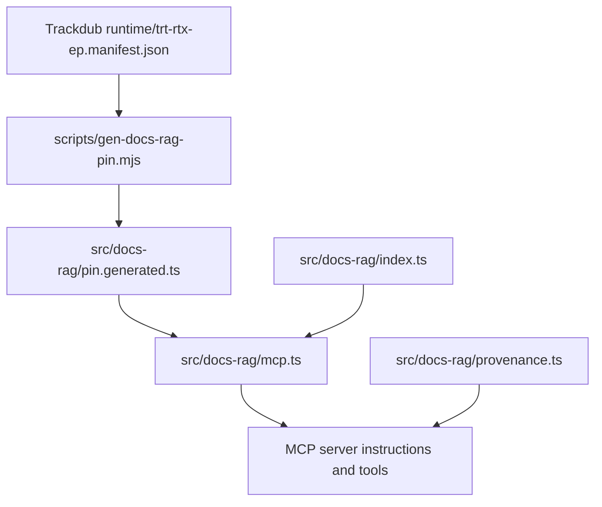
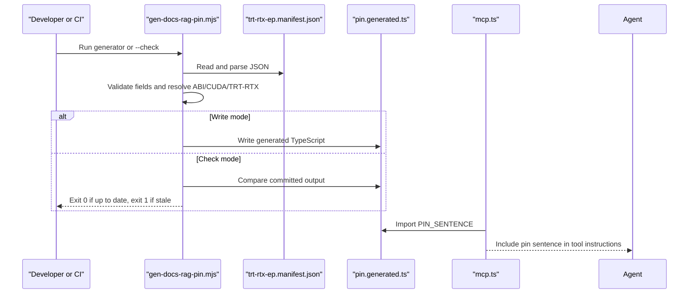
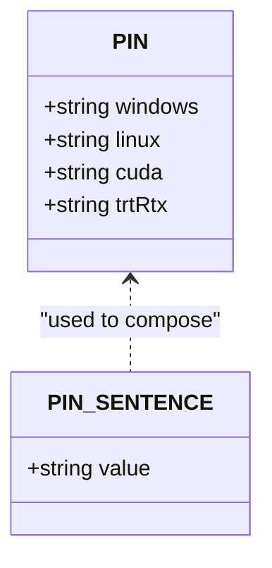
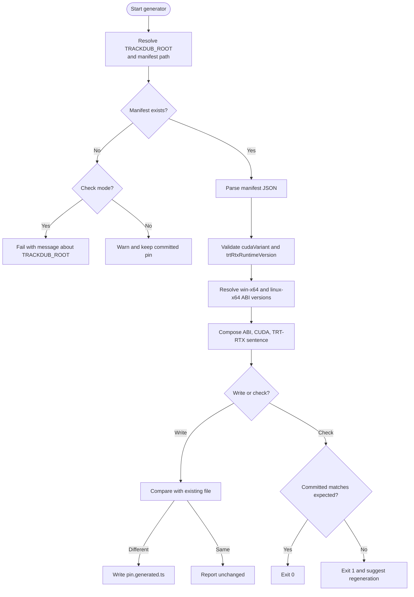
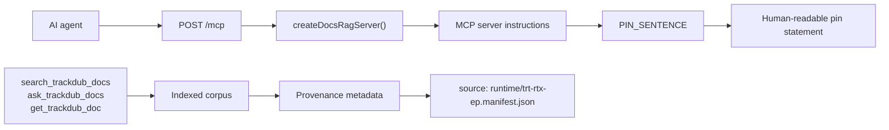
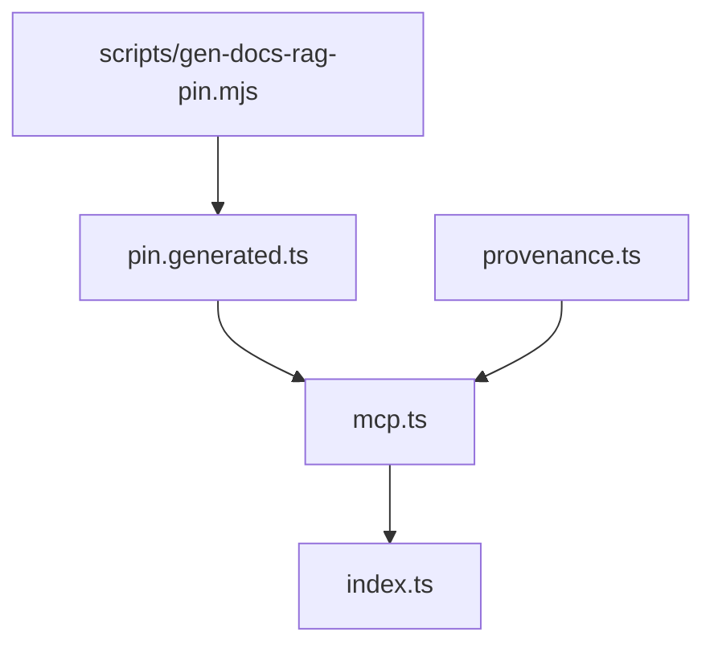

# Generated Pin Versioning

<cite>
**Referenced Files in This Document**
- [gen-docs-rag-pin.mjs](file://scripts/gen-docs-rag-pin.mjs)
- [pin.generated.ts](file://src/docs-rag/pin.generated.ts)
- [mcp.ts](file://src/docs-rag/mcp.ts)
- [index.ts](file://src/docs-rag/index.ts)
- [provenance.ts](file://src/docs-rag/provenance.ts)
- [README.md](file://README.md)
</cite>

## Table of Contents
1. [Introduction](#introduction)
2. [Purpose and Scope](#purpose-and-scope)
3. [Project Structure](#project-structure)
4. [Architecture Overview](#architecture-overview)
5. [Generated PIN Data Model](#generated-pin-data-model)
6. [Build Script Behavior](#build-script-behavior)
7. [Runtime Consumption](#runtime-consumption)
8. [Configuration](#configuration)
9. [Dependency Analysis](#dependency-analysis)
10. [Performance Considerations](#performance-considerations)
11. [Troubleshooting Guide](#troubleshooting-guide)
12. [Conclusion](#conclusion)

## Introduction
This document explains the generated pin versioning mechanism used by the Trackdub Docs RAG Worker. The script `scripts/gen-docs-rag-pin.mjs` derives ABI, CUDA, and TensorRT-RTX versions from the external `runtime/trt-rtx-ep.manifest.json` file maintained by the Trackdub repository and writes a committed TypeScript source file `src/docs-rag/pin.generated.ts`. That generated module exports both machine-readable version constants and a human-readable sentence embedded into MCP tool instructions.

The goal is to prevent agents and callers from drifting from the exact ABI/CUDA/TensorRT-RTX versions bundled with Trackdub, while keeping the pin visible in prompts and tool definitions rather than hidden behind hard-coded strings.

## Purpose and Scope
- Derive pinned versions from an authoritative manifest instead of duplicating them manually.
- Generate a single TypeScript module consumed by MCP tool instructions and provenance metadata.
- Provide a `--check` mode for CI or pre-deploy validation that fails when the committed pin does not match the current manifest.
- Make the resulting pin sentence readable in AI-facing documentation and tool descriptions so agents can state concrete versions.

Current scope is limited to this generation pipeline and its consumption inside the Docs RAG MCP server. Dubs, billing, keys, webhooks, and other API features are intentionally outside this document.

**Section sources**
- [gen-docs-rag-pin.mjs:1-68](file://scripts/gen-docs-rag-pin.mjs#L1-L68)
- [README.md:1-20](file://README.md#L1-L20)

## Project Structure
The feature spans two locations:

| Path | Responsibility |
|---|---|
| `scripts/gen-docs-rag-pin.mjs` | Node.js build-time generator; reads the Trackdub manifest and emits `pin.generated.ts`. |
| `src/docs-rag/pin.generated.ts` | Committed TypeScript module exporting `PIN` and `PIN_SENTENCE`. Not edited by hand. |
| `src/docs-rag/mcp.ts` | Imports `PIN_SENTENCE` and embeds it into MCP server instructions and tool descriptions. |
| `src/docs-rag/provenance.ts` | Marks the generated pin doc as sourced from `runtime/trt-rtx-ep.manifest.json`. |
| `src/docs-rag/index.ts` | Hosts the Hono app and MCP route; does not directly import the pin but depends on `mcp.ts`, which does. |

**Diagram sources**
- [gen-docs-rag-pin.mjs:1-68](file://scripts/gen-docs-rag-pin.mjs#L1-L68)
- [pin.generated.ts:1-9](file://src/docs-rag/pin.generated.ts#L1-L9)
- [mcp.ts:1-155](file://src/docs-rag/mcp.ts#L1-L155)
- [provenance.ts:1-125](file://src/docs-rag/provenance.ts#L1-L125)
- [index.ts:1-90](file://src/docs-rag/index.ts#L1-L90)

**Section sources**
- [gen-docs-rag-pin.mjs:1-68](file://scripts/gen-docs-rag-pin.mjs#L1-L68)
- [pin.generated.ts:1-9](file://src/docs-rag/pin.generated.ts#L1-L9)
- [mcp.ts:1-155](file://src/docs-rag/mcp.ts#L1-L155)
- [provenance.ts:1-125](file://src/docs-rag/provenance.ts#L1-L125)
- [index.ts:1-90](file://src/docs-rag/index.ts#L1-L90)

## Architecture Overview
At a high level, the flow has three stages:

1. **Manifest resolution:** The generator locates `runtime/trt-rtx-ep.manifest.json` either relative to the repository root or via `TRACKDUB_ROOT`.
2. **Validation and derivation:** It validates required fields and resolves Windows/Linux ABI versions from package archive URLs or the manifest fallback.
3. **Emission and consumption:** It writes `pin.generated.ts`, which the MCP server imports to describe pinned vendor dependencies to agents.

**Diagram sources**
- [gen-docs-rag-pin.mjs:1-68](file://scripts/gen-docs-rag-pin.mjs#L1-L68)
- [pin.generated.ts:1-9](file://src/docs-rag/pin.generated.ts#L1-L9)
- [mcp.ts:1-155](file://src/docs-rag/mcp.ts#L1-L155)

## Generated PIN Data Model
The generated file exports two top-level members:

| Export | Type | Meaning |
|---|---|---|
| `PIN` | Object with `windows`, `linux`, `cuda`, and `trtRtx` properties | Machine-readable pinned versions. `windows` and `linux` represent the TensorRT-RTX EP ABI version per platform. |
| `PIN_SENTENCE` | String | Human-readable statement summarizing ABI, CUDA, and TensorRT-RTX versions. Used in MCP instructions. |

Example shape (values come from the committed generated file):

**Diagram sources**
- [pin.generated.ts:1-9](file://src/docs-rag/pin.generated.ts#L1-L9)

Important constraints:
- The file must remain committed.
- It is regenerated only by the script; manual edits will be overwritten or rejected in `--check` mode.
- The ABI string may combine Windows and Linux versions when they differ.

**Section sources**
- [pin.generated.ts:1-9](file://src/docs-rag/pin.generated.ts#L1-L9)

## Build Script Behavior
### Entry Points
The script supports two primary invocations:

| Invocation | Behavior |
|---|---|
| `node scripts/gen-docs-rag-pin.mjs` | Reads the manifest, generates `pin.generated.ts`, and prints whether it wrote or left the file unchanged. |
| `node scripts/gen-docs-rag-pin.mjs --check` | Compares the expected generated content against the committed file and exits with code 1 when stale. |

### Manifest Resolution
The script computes paths relative to the script location, then resolves the manifest under:

- `Trackdub/runtime/trt-rtx-ep.manifest.json` by default, where `Trackdub` is a sibling directory.
- Or `process.env.TRACKDUB_ROOT/runtime/trt-rtx-ep.manifest.json` when `TRACKDUB_ROOT` is set.

If the manifest is missing:
- In write mode, it warns and exits successfully, preserving the existing committed pin.
- In check mode, it fails because verification cannot proceed without the manifest.

### Validation Rules
The generator requires:

- `manifest.cudaVariant` to be a non-empty string.
- `manifest.trtRtxRuntimeVersion` to be a non-empty string.
- Each platform ABI to resolve to a version from either:
  - `packages.<platform>.archiveUrl`, parsed from a `/v<semver>/` segment.
  - Or `manifest.version` as a fallback.

If no version can be resolved for a platform, the script throws.

### Version Composition
- `ABI windows`: Derived from the `win-x64` package.
- `ABI linux`: Derived from the `linux-x64` package.
- If both platforms share the same version, the ABI becomes a single version labeled for both platforms.
- Otherwise, the ABI combines Windows and Linux versions separated by ` / `.
- `CUDA` comes from `cudaVariant`.
- `TensorRT-RTX` comes from `trtRtxRuntimeVersion`.

### Output Format
The emitted file is a TypeScript module with:
- A generated header indicating origin and that it must not be edited.
- An exported `PIN` object with typed string values.
- An exported `PIN_SENTENCE` constructed from the derived ABI, CUDA, and TensorRT-RTX values.

**Diagram sources**
- [gen-docs-rag-pin.mjs:1-68](file://scripts/gen-docs-rag-pin.mjs#L1-L68)

**Section sources**
- [gen-docs-rag-pin.mjs:1-68](file://scripts/gen-docs-rag-pin.mjs#L1-L68)

## Runtime Consumption
### MCP Instructions
The MCP server created in `src/docs-rag/mcp.ts` imports `PIN_SENTENCE` and concatenates it into the server's `instructions`. This means agents receive a prompt that explicitly states the pinned ABI, CUDA, and TensorRT-RTX versions rather than relying on internal assumptions.

The instruction text also clarifies:
- The corpus covers Trackdub, vendor docs, and pinned components such as NVIDIA TRT-RTX/EP ABI.
- First-party documentation outranks vendor `/latest/` pages when they disagree.
- Agents should prefer search over synthesis and verify version numbers against cited hits.

### Tool Descriptions
Tool descriptions reference concrete implementation facts, including provider registration, EP ABI details, pin versions, and pipeline stages. While the description does not repeat the full sentence, it directs agents to consult the pin versions available through the generated context and corpus.

### Provenance Link
The generated pin document is treated specially in provenance logic. Its staged key maps to a source field identifying `runtime/trt-rtx-ep.manifest.json`, making clear that the pin originates from the external Trackdub manifest rather than a local checkout file.

**Diagram sources**
- [mcp.ts:1-155](file://src/docs-rag/mcp.ts#L1-L155)
- [index.ts:1-90](file://src/docs-rag/index.ts#L1-L90)
- [provenance.ts:1-125](file://src/docs-rag/provenance.ts#L1-L125)
- [pin.generated.ts:1-9](file://src/docs-rag/pin.generated.ts#L1-L9)

**Section sources**
- [mcp.ts:1-155](file://src/docs-rag/mcp.ts#L1-L155)
- [index.ts:1-90](file://src/docs-rag/index.ts#L1-L90)
- [provenance.ts:1-125](file://src/docs-rag/provenance.ts#L1-L125)
- [pin.generated.ts:1-9](file://src/docs-rag/pin.generated.ts#L1-L9)

## Configuration
### Environment Variables
| Variable | Kind | Default | Purpose |
|---|---|---|---|
| `TRACKDUB_ROOT` | Optional override | Sibling `../Trackdub` directory | Overrides where the generator looks for `runtime/trt-rtx-ep.manifest.json`. |
| `PORTAL_ORIGIN` | Public config | Set in `wrangler.jsonc` | Controls CORS and trusted origins for the main Worker; unrelated to pin generation but relevant to the overall environment. |

### Secret Management
Secrets such as `BETTER_AUTH_SECRET` and `ADMIN_API_TOKEN` are stored in `.dev.vars` locally or via `wrangler secret put`. They are not part of pin generation, but they illustrate the project’s fail-fast configuration model: configuration is validated early and secrets are never committed.

### Build and Deploy Implications
- In normal development, run the generator before dev or deploy to refresh the committed pin.
- In CI or deployment checks, use `--check` to enforce that the committed pin matches the current manifest.
- If `TRACKDUB_ROOT` points to the wrong checkout, the script cannot validate pins reliably.

**Section sources**
- [gen-docs-rag-pin.mjs:1-68](file://scripts/gen-docs-rag-pin.mjs#L1-L68)
- [README.md:22-60](file://README.md#L22-L60)

## Dependency Analysis
### Module Dependencies
- `scripts/gen-docs-rag-pin.mjs` depends on Node filesystem APIs and parses JSON from an external Trackdub checkout.
- `src/docs-rag/pin.generated.ts` has no runtime dependencies beyond being imported by TypeScript consumers.
- `src/docs-rag/mcp.ts` imports `PIN_SENTENCE` from the generated module.
- `src/docs-rag/provenance.ts` contributes provenance metadata tied to the generated pin document key.
- `src/docs-rag/index.ts` mounts routes and creates the MCP server but does not directly import the pin.

**Diagram sources**
- [gen-docs-rag-pin.mjs:1-68](file://scripts/gen-docs-rag-pin.mjs#L1-L68)
- [pin.generated.ts:1-9](file://src/docs-rag/pin.generated.ts#L1-L9)
- [mcp.ts:1-155](file://src/docs-rag/mcp.ts#L1-L155)
- [index.ts:1-90](file://src/docs-rag/index.ts#L1-L90)
- [provenance.ts:1-125](file://src/docs-rag/provenance.ts#L1-L125)

### Coupling Assessment
- The generated pin module is a low-coupling leaf: it is written by the generator and read by MCP tooling.
- The MCP layer introduces the pin into agent-visible behavior, increasing its importance for correctness.
- Provenance ties the generated pin document to its manifest source without creating a runtime dependency on the manifest itself.

**Section sources**
- [gen-docs-rag-pin.mjs:1-68](file://scripts/gen-docs-rag-pin.mjs#L1-L68)
- [mcp.ts:1-155](file://src/docs-rag/mcp.ts#L1-L155)
- [provenance.ts:1-125](file://src/docs-rag/provenance.ts#L1-L125)
- [index.ts:1-90](file://src/docs-rag/index.ts#L1-L90)

## Performance Considerations
- Generation runs at build time, not at request time, so it does not affect Worker latency.
- Reading and parsing one small JSON manifest is negligible compared to network or database operations.
- Writing the generated file occurs only when content differs, avoiding unnecessary commits.
- At runtime, importing the generated module adds no measurable overhead; the pin sentence is embedded once during MCP server construction.

[No sources needed since this section provides general guidance]

## Troubleshooting Guide
### Common Issues
| Symptom | Likely Cause | Resolution |
|---|---|---|
| `--check` reports the pin is stale | The manifest changed but `pin.generated.ts` was not regenerated. | Run the generator without `--check`, commit the updated file, and re-run `--check`. |
| `--check` fails because the manifest is missing | `TRACKDUB_ROOT` is unset or points to a checkout without `runtime/trt-rtx-ep.manifest.json`. | Set `TRACKDUB_ROOT` to the correct Trackdub repository path. |
| Generator warns it is keeping the committed pin | Manifest is missing in write mode. | Point the script at the correct Trackdub checkout using `TRACKDUB_ROOT`. |
| Generator throws about a missing ABI version | `win-x64` or `linux-x64` package archive URL does not contain a resolvable version. | Fix the manifest or restore the expected archive URL structure. |
| MCP tools show outdated versions | The committed `pin.generated.ts` does not match the current manifest. | Regenerate and commit the generated file. |
| Provenance shows the generated pin as coming from the manifest | Expected behavior. | No action required; this confirms the pin doc is recognized as manifest-derived. |

### Diagnostic Steps
1. Confirm the manifest path by inspecting `TRACKDUB_ROOT`.
2. Verify that `cudaVariant` and `trtRtxRuntimeVersion` exist and are non-empty strings.
3. Check that `packages.win-x64.archiveUrl` and `packages.linux-x64.archiveUrl` contain a resolvable semver segment.
4. Run the generator in write mode and review the printed sentence.
5. Run the generator in check mode to validate the committed file.
6. Inspect MCP instructions received by agents to confirm the pin sentence is present.

**Section sources**
- [gen-docs-rag-pin.mjs:1-68](file://scripts/gen-docs-rag-pin.mjs#L1-L68)
- [provenance.ts:1-125](file://src/docs-rag/provenance.ts#L1-L125)

## Conclusion
The generated pin versioning mechanism replaces hard-coded ABI, CUDA, and TensorRT-RTX strings with a single source of truth: `runtime/trt-rtx-ep.manifest.json`. The generator produces a committed TypeScript module that exposes both structured versions and a human-readable sentence. MCP tool instructions consume that sentence so agents can see and reason about the exact pinned versions. The `--check` mode and `TRACKDUB_ROOT` override make this a reliable build/deploy concern, while runtime consumption remains simple, deterministic, and agent-friendly.

[No sources needed since this section summarizes without analyzing specific files]