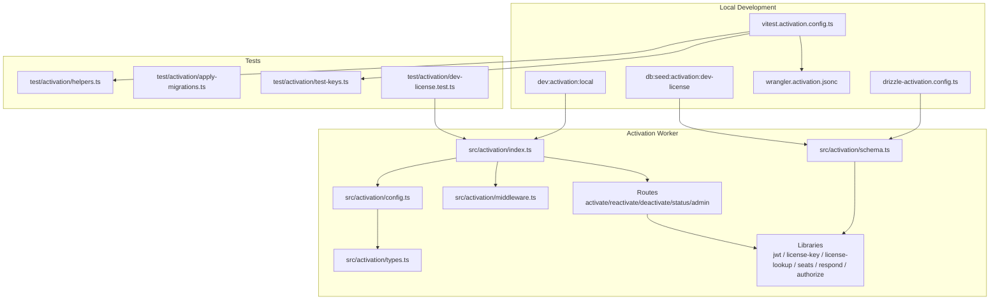
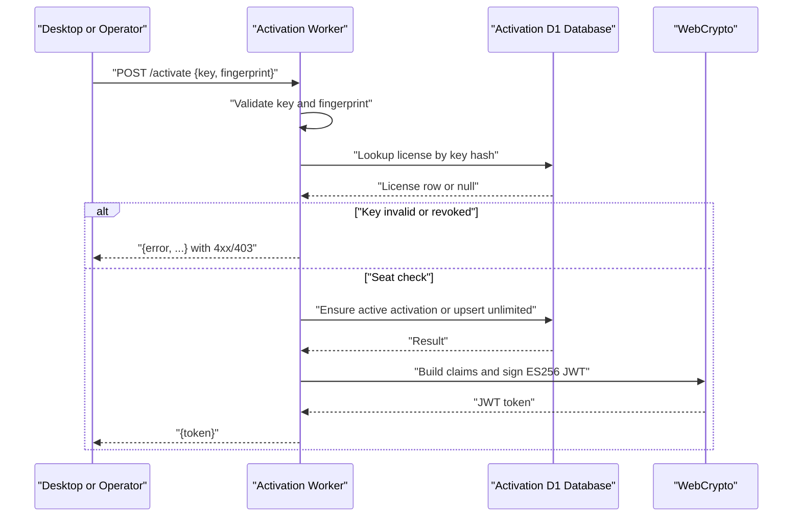
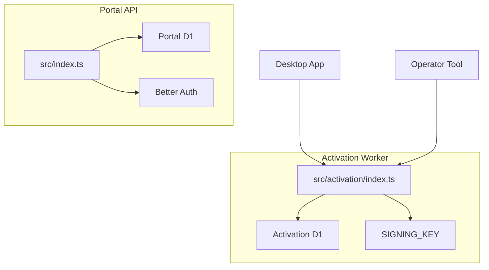
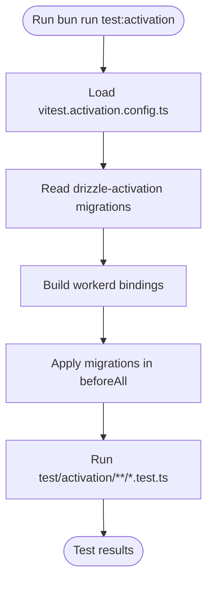
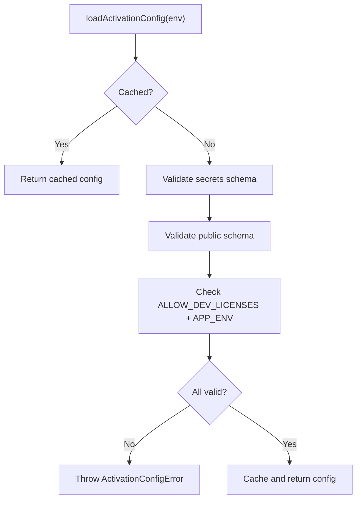
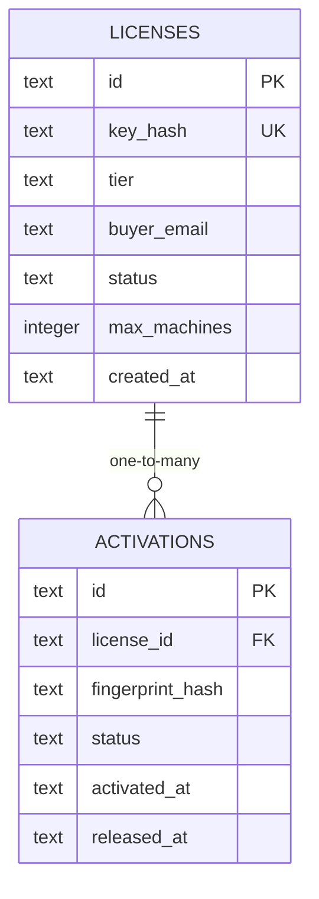
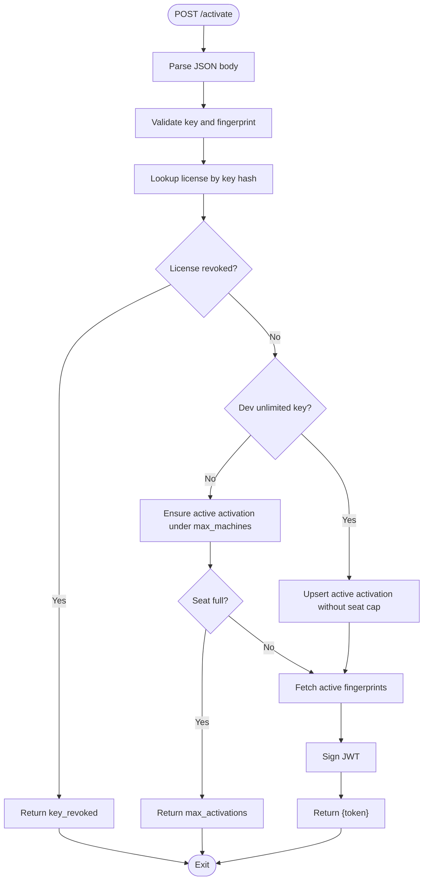
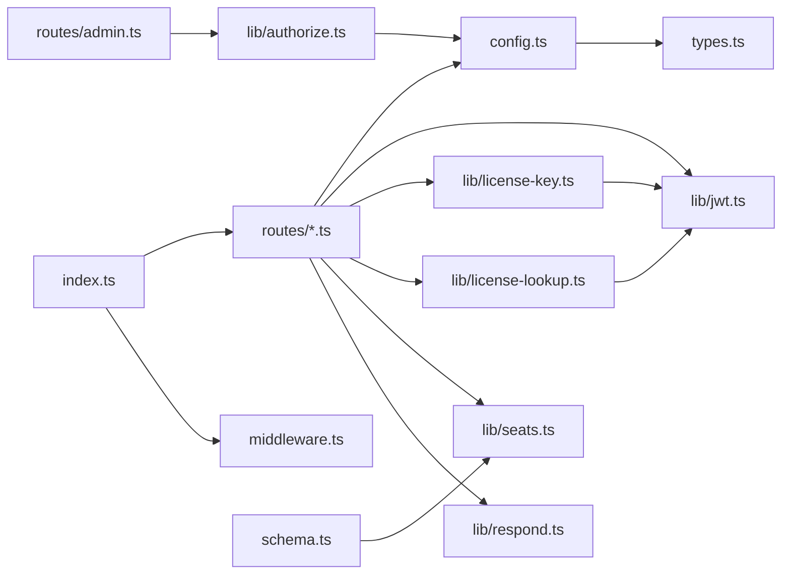

# Activation Service Development

<cite>
**Referenced Files in This Document**   
- [package.json](file://package.json)
- [vitest.activation.config.ts](file://vitest.activation.config.ts)
- [wrangler.activation.jsonc](file://wrangler.activation.jsonc)
- [drizzle-activation.config.ts](file://drizzle-activation.config.ts)
- [src/activation/index.ts](file://src/activation/index.ts)
- [src/activation/config.ts](file://src/activation/config.ts)
- [src/activation/middleware.ts](file://src/activation/middleware.ts)
- [src/activation/types.ts](file://src/activation/types.ts)
- [src/activation/schema.ts](file://src/activation/schema.ts)
- [src/activation/routes/activate.ts](file://src/activation/routes/activate.ts)
- [src/activation/routes/reactivate.ts](file://src/activation/routes/reactivate.ts)
- [src/activation/routes/deactivate.ts](file://src/activation/routes/deactivate.ts)
- [src/activation/routes/status.ts](file://src/activation/routes/status.ts)
- [src/activation/routes/admin.ts](file://src/activation/routes/admin.ts)
- [src/activation/lib/jwt.ts](file://src/activation/lib/jwt.ts)
- [src/activation/lib/license-key.ts](file://src/activation/lib/license-key.ts)
- [src/activation/lib/license-lookup.ts](file://src/activation/lib/license-lookup.ts)
- [src/activation/lib/seats.ts](file://src/activation/lib/seats.ts)
- [src/activation/lib/respond.ts](file://src/activation/lib/respond.ts)
- [src/activation/lib/authorize.ts](file://src/activation/lib/authorize.ts)
- [test/activation/helpers.ts](file://test/activation/helpers.ts)
- [test/activation/apply-migrations.ts](file://test/activation/apply-migrations.ts)
- [test/activation/test-keys.ts](file://test/activation/test-keys.ts)
- [test/activation/dev-license.test.ts](file://test/activation/dev-license.test.ts)
- [docs/ACTIVATION-CONTRACT.md](file://docs/ACTIVATION-CONTRACT.md)
</cite>

## Table of Contents
1. [Introduction](#introduction)
2. [Project Structure](#project-structure)
3. [Core Components](#core-components)
4. [Architecture Overview](#architecture-overview)
5. [Detailed Component Analysis](#detailed-component-analysis)
6. [Dependency Analysis](#dependency-analysis)
7. [Performance Considerations](#performance-considerations)
8. [Troubleshooting Guide](#troubleshooting-guide)
9. [Conclusion](#conclusion)

## Introduction
The activation service is a separate Cloudflare Worker (`trackdub-activation`) that signs desktop license tokens, tracks per-machine activations, and exposes operator-only key minting. It runs on its own D1 database, its own signing key, and its own domain (`activate.trackdub.com`), so a bug in the portal API cannot reach the private license-signing material.

This documentation focuses on the new activation Worker with its dedicated local development tooling:

| Tool | Purpose | Command or file |
|---|---|---|
| Local development server | Runs the activation Worker in `activation-local` mode on port 8787 | `bun run dev:activation:local` |
| Dev license seed | Inserts the fixed development license key into the local activation D1 database | `bun run db:seed:activation:dev-license` |
| Activation test suite | Runs activation tests against workerd using a dedicated Vitest configuration | `bun run test:activation` |

The activation Worker is intentionally not part of the main portal API entry point; it has disjoint bindings, migrations, configuration, and secrets.

**Section sources**
- [package.json:10-39](file://package.json#L10-L39)
- [src/activation/index.ts:10-34](file://src/activation/index.ts#L10-L34)
- [src/activation/types.ts:3-14](file://src/activation/types.ts#L3-L14)
- [docs/ACTIVATION-CONTRACT.md:1-22](file://docs/ACTIVATION-CONTRACT.md#L1-L22)

## Project Structure
The activation codebase is organized by deployment boundary rather than by feature alone:

**Diagram sources**
- [src/activation/index.ts:1-34](file://src/activation/index.ts#L1-L34)
- [src/activation/config.ts:1-95](file://src/activation/config.ts#L1-L95)
- [src/activation/types.ts:1-48](file://src/activation/types.ts#L1-L48)
- [src/activation/schema.ts:1-51](file://src/activation/schema.ts#L1-L51)
- [vitest.activation.config.ts:1-49](file://vitest.activation.config.ts#L1-L49)
- [wrangler.activation.jsonc:1-36](file://wrangler.activation.jsonc#L1-L36)
- [drizzle-activation.config.ts:1-14](file://drizzle-activation.config.ts#L1-L14)
- [test/activation/helpers.ts:1-35](file://test/activation/helpers.ts#L1-L35)
- [test/activation/apply-migrations.ts:1-11](file://test/activation/apply-migrations.ts#L1-L11)
- [test/activation/test-keys.ts:1-20](file://test/activation/test-keys.ts#L1-L20)
- [test/activation/dev-license.test.ts:1-77](file://test/activation/dev-license.test.ts#L1-L77)

The structure follows a clear separation between runtime code, configuration, data model, routes, shared libraries, and the activation-specific test environment. The migration and wrangler configuration live outside `src/` because they describe how the activation Worker is built and deployed, not what it computes.

**Section sources**
- [src/activation/index.ts:1-34](file://src/activation/index.ts#L1-L34)
- [src/activation/schema.ts:1-51](file://src/activation/schema.ts#L1-L51)
- [vitest.activation.config.ts:1-49](file://vitest.activation.config.ts#L1-L49)
- [wrangler.activation.jsonc:1-36](file://wrangler.activation.jsonc#L1-L36)
- [drizzle-activation.config.ts:1-14](file://drizzle-activation.config.ts#L1-L14)

## Core Components
The activation Worker is a Hono application composed of:

| Layer | Responsibility | Key files |
|---|---|---|
| Entry point | Creates the Hono app, mounts global middleware, and registers `/activate`, `/reactivate`, `/deactivate`, `/status`, and `/admin` | [src/activation/index.ts](file://src/activation/index.ts) |
| Configuration | Validates `SIGNING_KEY`, `ADMIN_API_TOKEN`, issuer/audience/key id, and enforces that dev licenses are never enabled in production | [src/activation/config.ts](file://src/activation/config.ts) |
| Request middleware | Adds request IDs, logs requests, and centralizes error handling | [src/activation/middleware.ts](file://src/activation/middleware.ts) |
| Data model | Defines `licenses` and `activations` tables for the activation D1 database | [src/activation/schema.ts](file://src/activation/schema.ts) |
| Routing | Desktop-facing activation endpoints and operator-only admin endpoint | [src/activation/routes/*.ts](file://src/activation/routes/activate.ts) |
| Libraries | JWT signing, license key generation/lookup, seat accounting, response helpers, and admin authorization | [src/activation/lib/*.ts](file://src/activation/lib/jwt.ts) |
| Test tooling | workerd test config, test bindings, test keys, migration setup, and dev-license assertions | [vitest.activation.config.ts](file://vitest.activation.config.ts), [test/activation/*](file://test/activation/dev-license.test.ts) |

The activation Worker does not share `Bindings` types with the portal API. That isolation is deliberate: the `SIGNING_KEY` secret must only be reachable from activation code.

**Section sources**
- [src/activation/index.ts:10-34](file://src/activation/index.ts#L10-L34)
- [src/activation/config.ts:1-95](file://src/activation/config.ts#L1-L95)
- [src/activation/middleware.ts:1-67](file://src/activation/middleware.ts#L1-L67)
- [src/activation/schema.ts:1-51](file://src/activation/schema.ts#L1-L51)
- [src/activation/types.ts:1-48](file://src/activation/types.ts#L1-L48)

## Architecture Overview
At runtime, the activation Worker receives HTTP requests from the desktop client or operators and responds with either signed license tokens or status/error envelopes.

**Diagram sources**
- [src/activation/routes/activate.ts:1-76](file://src/activation/routes/activate.ts#L1-L76)
- [src/activation/lib/license-lookup.ts:1-11](file://src/activation/lib/license-lookup.ts#L1-L11)
- [src/activation/lib/seats.ts:1-200](file://src/activation/lib/seats.ts#L1-L200)
- [src/activation/lib/jwt.ts:60-133](file://src/activation/lib/jwt.ts#L60-L133)

The activation service is conceptually distinct from the portal API even though both live in the same repository:

**Diagram sources**
- [src/activation/types.ts:3-14](file://src/activation/types.ts#L3-L14)
- [src/activation/index.ts:10-34](file://src/activation/index.ts#L10-L34)
- [wrangler.activation.jsonc:1-36](file://wrangler.activation.jsonc#L1-L36)

**Section sources**
- [src/activation/index.ts:10-34](file://src/activation/index.ts#L10-L34)
- [src/activation/types.ts:1-48](file://src/activation/types.ts#L1-L48)
- [docs/ACTIVATION-CONTRACT.md:1-22](file://docs/ACTIVATION-CONTRACT.md#L1-L22)

## Detailed Component Analysis

### Local Development Tooling

#### `dev:activation:local` script
The script starts the activation Worker locally with the `activation-local` mode and binds it to port 8787. It uses the Cloudflare CLI rather than the older `wrangler dev` command used by the portal.

| Aspect | Detail |
|---|---|
| Script name | `dev:activation:local` |
| Underlying command | `cf dev --mode activation-local --port 8787` |
| Deployment mode | `activation-local` |
| Port | 8787 |
| Intended use | Local integration testing of the activation Worker |

The activation Worker itself listens at path prefixes `/activate`, `/reactivate`, `/deactivate`, `/status`, and `/admin`. Its default route prefix is not changed by this script; developers call the full paths relative to the local workerd server.

**Section sources**
- [package.json:16-21](file://package.json#L16-L21)
- [src/activation/index.ts:22-33](file://src/activation/index.ts#L22-L33)

#### `db:seed:activation:dev-license` script
The seed script inserts a fixed development license key directly into the local activation D1 database using `cf d1 query`. It targets the activation database ID `f95337b1-aff5-455d-a0f9-3293211b1727` and uses `INSERT OR IGNORE` so repeated runs do not fail if the row already exists.

| Field | Value |
|---|---|
| Database binding | Activation D1 |
| License ID | Hardcoded UUID used for the dev key |
| Key hash | SHA-256 of `TDUB-DEV-UNLIMITED-LOCAL` |
| Tier | `pro` |
| Buyer email | `dev@local` |
| Status | `active` |
| Max machines | 1 (the dev key bypasses this cap when enabled) |

The test suite verifies that the seed script's SQL still contains the correct SHA-256 hash of the dev license key, preventing silent drift between the hardcoded key literal and the seed SQL.

**Section sources**
- [package.json:26-30](file://package.json#L26-L30)
- [test/activation/dev-license.test.ts:1-77](file://test/activation/dev-license.test.ts#L1-L77)
- [src/activation/lib/license-key.ts:20-29](file://src/activation/lib/license-key.ts#L20-L29)

#### Activation test suite via `vitest.activation.config.ts`
The activation test configuration sets up an isolated test environment for the activation Worker:

| Configuration area | Behavior |
|---|---|
| Runtime | Real `workerd` through `@cloudflare/vitest-pool-workers` |
| Wrangler config | `./wrangler.activation.jsonc` |
| Bindings | APP_ENV, issuer, audience, key id, signing key, admin token, and dev license flag |
| Migrations | Read from `drizzle-activation` and applied once before tests |
| Test include pattern | `test/activation/**/*.test.ts` |
| Setup file | `test/activation/apply-migrations.ts` |
| Module alias | `@` maps to `src` |

The test signing keypair lives in `test/activation/test-keys.ts` as plain PEM strings. It is deliberately Node-importable from the Vitest configuration while remaining safe to import from workerd test files.

**Diagram sources**
- [vitest.activation.config.ts:1-49](file://vitest.activation.config.ts#L1-L49)
- [test/activation/apply-migrations.ts:1-11](file://test/activation/apply-migrations.ts#L1-L11)
- [test/activation/test-keys.ts:1-20](file://test/activation/test-keys.ts#L1-L20)

**Section sources**
- [vitest.activation.config.ts:1-49](file://vitest.activation.config.ts#L1-L49)
- [test/activation/helpers.ts:1-35](file://test/activation/helpers.ts#L1-L35)
- [test/activation/apply-migrations.ts:1-11](file://test/activation/apply-migrations.ts#L1-L11)
- [test/activation/test-keys.ts:1-20](file://test/activation/test-keys.ts#L1-L20)

### Configuration and Secrets

#### Activation configuration validation
Configuration is validated on first access and cached. Validation covers:

- `SIGNING_KEY`: required PKCS#8 PEM private key containing `BEGIN PRIVATE KEY`.
- `ADMIN_API_TOKEN`: required string with at least 16 characters.
- `APP_ENV`: must be one of `development`, `staging`, or `production`.
- `ACTIVATION_ISSUER`: required valid URL.
- `ACTIVATION_AUDIENCE`: required non-empty string.
- `SIGNING_KEY_ID`: required non-empty string.
- `ALLOW_DEV_LICENSES`: optional boolean-like string that enables the fixed dev license key outside production.

If any validation fails, the Worker throws `ActivationConfigError`, which the global error handler converts to a generic `server_error` 500 response without leaking exception details.

**Diagram sources**
- [src/activation/config.ts:1-95](file://src/activation/config.ts#L1-L95)
- [src/activation/middleware.ts:36-67](file://src/activation/middleware.ts#L36-L67)

**Section sources**
- [src/activation/config.ts:1-95](file://src/activation/config.ts#L1-L95)
- [src/activation/middleware.ts:36-67](file://src/activation/middleware.ts#L36-L67)

### Data Model

#### Activation database schema
The activation service owns two tables in its own D1 database. They have no foreign-key relationship to portal users or sessions.

| Table | Columns | Constraints |
|---|---|---|
| `licenses` | `id`, `key_hash`, `tier`, `buyer_email`, `status`, `max_machines`, `created_at` | `id` primary key; `key_hash` unique |
| `activations` | `id`, `license_id`, `fingerprint_hash`, `status`, `activated_at`, `released_at` | `id` primary key; unique index on `(license_id, fingerprint_hash)`; additional index on `(license_id, status)` |

The index on `(license_id, status)` exists because seat accounting and `/status` repeatedly filter by active activations per license. Without it, many historical `released` rows would degrade queries to scans.

**Diagram sources**
- [src/activation/schema.ts:1-51](file://src/activation/schema.ts#L1-L51)

**Section sources**
- [src/activation/schema.ts:1-51](file://src/activation/schema.ts#L1-L51)

### Activation Routes

#### POST `/activate`
Registers a machine fingerprint against a license key and returns a signed JWT.

Validation order:

1. Parse JSON body.
2. Accept object-like payload; guard against `null` bodies.
3. Validate key length and fingerprint hex format.
4. Look up license by hashed key.
5. Reject revoked keys.
6. Determine whether the key is the dev-unlimited key.
7. Either upsert without seat limits or enforce `max_machines`.
8. Fetch active fingerprints.
9. Build and sign an ES256 JWT.

**Diagram sources**
- [src/activation/routes/activate.ts:1-76](file://src/activation/routes/activate.ts#L1-L76)
- [src/activation/lib/respond.ts:1-54](file://src/activation/lib/respond.ts#L1-L54)
- [src/activation/lib/seats.ts:1-200](file://src/activation/lib/seats.ts#L1-L200)
- [src/activation/lib/jwt.ts:60-133](file://src/activation/lib/jwt.ts#L60-L133)

#### POST `/reactivate`
Releases one existing activation and registers a replacement fingerprint. It is currently intended for support workflows rather than the shipped desktop build.

Important behavior:

- If the old fingerprint is the same as the new fingerprint, the route skips the swap but still refreshes the active machine list and returns a token.
- For capped licenses, it uses `replaceActivationSeat`, which atomically releases the old seat and claims a new one under `max_machines`.
- For the dev-unlimited key, it explicitly avoids the capped path and uses `releaseActivation` plus `upsertActiveActivationUnlimited`.
- A concurrent `/activate` can claim the freed seat; in that case, the old seat is restored and the caller receives a max-activation error.

#### POST `/deactivate`
Releases the active seat for a given license key and fingerprint. It is idempotent: if no active activation exists, it returns `200 {status: "released"}` because the desktop treats any 2xx response as success.

#### POST `/status`
Returns license metadata including tier, status, number of active activations, maximum activations, expiration, and whether the dev-unlimited flag applies.

It intentionally takes `key` in the request body rather than a query parameter because Cloudflare Workers Observability captures full URLs, including query strings.

#### POST `/admin/licenses`
Operator-only endpoint guarded by `Authorization: Bearer <ADMIN_API_TOKEN>`. It generates a random license key, hashes it, and inserts the license row. On a rare unique-constraint collision on `key_hash`, it retries up to five times.

Errors from this route throw and are caught by the activation Worker's centralized `onError`, returning the portal-style structured error envelope instead of the flat desktop envelope.

**Section sources**
- [src/activation/routes/activate.ts:1-76](file://src/activation/routes/activate.ts#L1-L76)
- [src/activation/routes/reactivate.ts:1-104](file://src/activation/routes/reactivate.ts#L1-L104)
- [src/activation/routes/deactivate.ts:1-57](file://src/activation/routes/deactivate.ts#L1-L57)
- [src/activation/routes/status.ts:1-68](file://src/activation/routes/status.ts#L1-L68)
- [src/activation/routes/admin.ts:1-73](file://src/activation/routes/admin.ts#L1-L73)

### JWT and Licensing Libraries

#### JWT signing
The activation service issues ES256 JWTs using WebCrypto and a PKCS#8 P-256 private key.

Key implementation details:

- Header includes `alg: ES256`, `typ: JWT`, and `kid`.
- Payload includes `sub`, `tier`, `machines`, `iat`, `exp`, `kid`, `iss`, `aud`, and optionally `dev_unlimited`.
- `kid` is placed in both header and payload because the desktop parser reads it from the payload.
- Signature is raw ECDSA `r||s`, matching the .NET desktop's expected IEEE P1363 format.
- Tokens are perpetual by default (`exp` is null); revocation is enforced at the next online activation.

#### License key utilities
License keys follow the `TDUB-XXXX-XXXX-XXXX-XXXX` format. They are generated using `crypto.getRandomValues` and hashed with SHA-256 before lookup. The fixed development key is `TDUB-DEV-UNLIMITED-LOCAL`; it bypasses seat caps only when `ALLOW_DEV_LICENSES=true` and the environment is not production.

#### Seat accounting
Seat accounting is implemented in raw SQL because concurrency correctness depends on embedding seat-count predicates in the same statement as each write. The important behaviors are:

- Existing active fingerprints are idempotent.
- Released rows can be revived if a seat is available.
- New activations count active seats inline.
- Race conditions are handled by checking whether another request already inserted the desired fingerprint.
- `/reactivate` restores the old activation if a concurrent activation fills the freed seat.

**Section sources**
- [src/activation/lib/jwt.ts:1-133](file://src/activation/lib/jwt.ts#L1-L133)
- [src/activation/lib/license-key.ts:1-29](file://src/activation/lib/license-key.ts#L1-L29)
- [src/activation/lib/license-lookup.ts:1-11](file://src/activation/lib/license-lookup.ts#L1-L11)
- [src/activation/lib/seats.ts:1-228](file://src/activation/lib/seats.ts#L1-L228)

## Dependency Analysis
The activation Worker has a small, layered dependency graph. There is no circular dependency among the core modules.

**Diagram sources**
- [src/activation/index.ts:1-34](file://src/activation/index.ts#L1-L34)
- [src/activation/routes/activate.ts:1-76](file://src/activation/routes/activate.ts#L1-L76)
- [src/activation/routes/reactivate.ts:1-104](file://src/activation/routes/reactivate.ts#L1-L104)
- [src/activation/routes/deactivate.ts:1-57](file://src/activation/routes/deactivate.ts#L1-L57)
- [src/activation/routes/status.ts:1-68](file://src/activation/routes/status.ts#L1-L68)
- [src/activation/routes/admin.ts:1-73](file://src/activation/routes/admin.ts#L1-L73)
- [src/activation/lib/jwt.ts:1-133](file://src/activation/lib/jwt.ts#L1-L133)
- [src/activation/lib/license-key.ts:1-29](file://src/activation/lib/license-key.ts#L1-L29)
- [src/activation/lib/license-lookup.ts:1-11](file://src/activation/lib/license-lookup.ts#L1-L11)
- [src/activation/lib/seats.ts:1-228](file://src/activation/lib/seats.ts#L1-L228)
- [src/activation/lib/respond.ts:1-54](file://src/activation/lib/respond.ts#L1-L54)
- [src/activation/lib/authorize.ts:1-23](file://src/activation/lib/authorize.ts#L1-L23)
- [src/activation/config.ts:1-95](file://src/activation/config.ts#L1-L95)
- [src/activation/types.ts:1-48](file://src/activation/types.ts#L1-L48)
- [src/activation/schema.ts:1-51](file://src/activation/schema.ts#L1-L51)

The most important coupling is between routes and the seat-accounting library. The route layer delegates business decisions about capped versus unlimited activations to `seats.ts`, while `respond.ts` provides the wire-compatible flat error envelope.

**Section sources**
- [src/activation/routes/activate.ts:1-76](file://src/activation/routes/activate.ts#L1-L76)
- [src/activation/lib/seats.ts:1-228](file://src/activation/lib/seats.ts#L1-L228)
- [src/activation/lib/respond.ts:1-54](file://src/activation/lib/respond.ts#L1-L54)

## Performance Considerations
Several design choices in the activation Worker affect performance and safety:

| Concern | Implementation | Implication |
|---|---|---|
| Input validation before DB lookup | Keys are bounded to 128 characters; fingerprints are strictly 64 lowercase hex characters | Prevents unbounded hashing work on unauthenticated endpoints |
| License lookup | Uses precomputed SHA-256 key hash with a unique index | Constant-time lookup by hashed key |
| Active activation counting | Dedicated index on `(license_id, status)` | Avoids scanning all historical `released` rows |
| Seat contention | Inline `COUNT(*) < max_machines` predicates in INSERT/UPDATE statements | SQLite serializes writes; races cannot exceed seat limits |
| Reactivate race recovery | Restores old activation if a concurrent activation fills the freed seat | Preserves seat cap during concurrent swaps |
| Admin key generation | Bounded retry loop on unique-constraint collision | Rare hash collisions become normal failures rather than 500 errors |
| Configuration caching | Config is memoized after first successful load | Avoids repeated Zod validation and secret parsing |
| Response envelope | Flat `{error, ...}` for desktop routes | Matches shipped desktop parsing logic; avoids extra serialization layers |

There is no caching layer for license lookups or active activation counts; every request reads from D1. This is acceptable for the current scope because activation traffic is low-frequency compared to hot API endpoints.

[No sources needed since this section provides general guidance]

## Troubleshooting Guide

### Local development

| Problem | Likely cause | Resolution |
|---|---|---|
| `dev:activation:local` cannot connect to the activation database | Local D1 database is missing or migrations were not applied | Run `bun run db:migrate:activation:local` |
| `/activate` returns `invalid_key` for the dev license | The dev license row was not seeded or the seed SQL drifted from the hardcoded key | Run `bun run db:seed:activation:dev-license` and confirm the hash matches the test assertion |
| Tests fail to resolve `@/activation/*` | Module alias not configured for the activation test runner | Use `bun run test:activation`, which loads `vitest.activation.config.ts` |
| Tests fail to find tables | Migrations were not applied to the test D1 | `test/activation/apply-migrations.ts` applies them in `beforeAll` |
| Signing fails locally | `SIGNING_KEY` is missing, malformed, or not a PKCS#8 PEM key | Provide a valid P-256 private key via the activation config |
| Admin route returns forbidden | Missing or incorrect `Authorization: Bearer` token | Set `ADMIN_API_TOKEN` in the activation environment and pass the same value in the request header |
| Dev license still respects `max_machines` | `ALLOW_DEV_LICENSES` is not set to `"true"` or `APP_ENV` is `production` | Enable `ALLOW_DEV_LICENSES=true` in the activation test bindings and ensure environment is not production |

### Production and staging

| Problem | Likely cause | Resolution |
|---|---|---|
| Worker fails to start | Invalid activation configuration | Inspect logs for `activation configuration error` and fix missing or invalid env vars/secrets |
| Desktop cannot verify tokens | `SIGNING_KEY_ID` does not match a key in the desktop trust ring | Add the public key to the trust ring and update `SIGNING_KEY_ID` after rotation |
| `/admin/licenses` returns portal-style errors | Expected behavior for the operator-only route | Do not expect the flat desktop envelope here |
| Dev license works in production | `ALLOW_DEV_LICENSES` leaked into a production environment | Configuration validation rejects dev licenses in production; investigate environment variable leakage |

**Section sources**
- [package.json:16-39](file://package.json#L16-L39)
- [vitest.activation.config.ts:1-49](file://vitest.activation.config.ts#L1-L49)
- [src/activation/config.ts:36-95](file://src/activation/config.ts#L36-L95)
- [src/activation/middleware.ts:36-67](file://src/activation/middleware.ts#L36-L67)
- [test/activation/dev-license.test.ts:1-77](file://test/activation/dev-license.test.ts#L1-L77)

## Conclusion
The activation service is a narrowly scoped, security-isolated Cloudflare Worker responsible for license token signing, seat accounting, and operator-driven key minting. Its development surface is intentionally separated from the portal API through its own entry point, configuration, D1 database, wrangler configuration, Drizzle migrations, and Vitest configuration.

For day-to-day work:

- Use `bun run dev:activation:local` to run the activation Worker locally.
- Use `bun run db:seed:activation:dev-license` to seed the fixed development license key.
- Use `bun run test:activation` to run the activation-specific test suite.
- Use `bun run db:generate:activation` and `bun run db:migrate:activation:local` to evolve the activation schema.

The most important architectural rule remains unchanged: the activation Worker owns the private signing key and its own database, and the portal API must never touch those resources.

[No sources needed since this section summarizes without analyzing specific files]