# Docs RAG First-Party Provenance

<cite>
**Referenced Files in This Document**
- [provenance.ts](file://src/docs-rag/provenance.ts)
- [types.ts](file://src/docs-rag/types.ts)
- [index.ts](file://src/docs-rag/index.ts)
- [query.ts](file://src/docs-rag/query.ts)
- [scopes.ts](file://src/docs-rag/scopes.ts)
- [corpus.ts](file://src/docs-rag/corpus.ts)
- [mcp.ts](file://src/docs-rag/mcp.ts)
- [pin.generated.ts](file://src/docs-rag/pin.generated.ts)
- [docs-rag-provenance.test.ts](file://test/docs-rag-provenance.test.ts)
</cite>

## Update Summary
**Changes Made**
- Enhanced documentation for defensive handling of malformed `files` values in sync manifests (non-array, string, or missing values)
- Added detailed coverage of the `syncedDirty` flag behavior for repositories synced from working trees with uncommitted changes
- Clarified the strict membership check requiring both file-list inclusion AND index freshness before commit stamping
- Updated troubleshooting guidance to address malformed manifest fields and dirty tree scenarios
- Expanded test coverage descriptions for defensive programming patterns

## Table of Contents
1. [Introduction](#introduction)
2. [Project Structure](#project-structure)
3. [Core Components](#core-components)
4. [Architecture Overview](#architecture-overview)
5. [Detailed Component Analysis](#detailed-component-analysis)
6. [Dependency Analysis](#dependency-analysis)
7. [Performance Considerations](#performance-considerations)
8. [Troubleshooting Guide](#troubleshooting-guide)
9. [Conclusion](#conclusion)

## Introduction
This document describes the first-party provenance layer for the Trackdub Docs RAG Worker. Its purpose is to enrich search results with source attribution: repository name, local path, synced commit, dirty flag, and sync timestamp. The feature reads a `_sync.json` manifest stored under `first-party/_sync.json` in the R2 corpus bucket, caches it briefly, and stamps only first-party hits. Vendor hits remain unmodified; the manifest itself is filtered out of results.

The implementation is fail-safe: missing, malformed, or unreadable manifests degrade to no stamp rather than failing a search. Tests cover LRU-style caching, manifest filtering, error degradation, pin-text assertions, malformed field handling, and end-to-end result enrichment.

**Updated** Recent enhancements include defensive handling of malformed `files` values, explicit `syncedDirty` flag support for dirty working trees, and strict dual-gate validation requiring both manifest membership and index freshness before committing provenance data.

## Project Structure
The provenance layer lives inside the existing `src/docs-rag/` module and integrates into the Hono server at `/v1/search` and `/v1/ask`. It does not introduce new HTTP endpoints; instead, it wraps downstream search results before they are returned to clients.

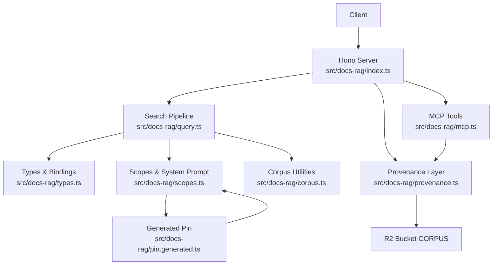

**Diagram sources**
- [index.ts:1-90](file://src/docs-rag/index.ts#L1-L90)
- [query.ts:1-200](file://src/docs-rag/query.ts#L1-L200)
- [types.ts:1-113](file://src/docs-rag/types.ts#L1-L113)
- [provenance.ts:1-125](file://src/docs-rag/provenance.ts#L1-L125)
- [scopes.ts:1-84](file://src/docs-rag/scopes.ts#L1-L84)
- [corpus.ts:1-39](file://src/docs-rag/corpus.ts#L1-L39)
- [mcp.ts:1-155](file://src/docs-rag/mcp.ts#L1-L155)
- [pin.generated.ts:1-9](file://src/docs-rag/pin.generated.ts#L1-L9)

**Section sources**
- [index.ts:1-90](file://src/docs-rag/index.ts#L1-L90)
- [provenance.ts:1-125](file://src/docs-rag/provenance.ts#L1-L125)
- [types.ts:1-113](file://src/docs-rag/types.ts#L1-L113)

## Core Components
| Component | Responsibility | Key Exports |
|---|---|---|
| `provenance.ts` | Loads the sync manifest, caches it, parses first-party keys, validates fields defensively, and stamps search hits using freshness-aware commit logic with strict membership requirements. | `SYNC_KEY`, `SyncManifest`, `loadSyncManifest`, `provenanceFor`, `withProvenance`, `resetSyncManifestCache` |
| `types.ts` | Defines Docs RAG bindings, including the `CORPUS` R2 bucket used by provenance. | `DocsRagBindings`, `DocsRagSearchResult`, related shapes |
| `index.ts` | Mounts Hono routes that call `withProvenance` around search and ask responses with consistent error handling. | Default Hono app exporting `/health`, `/mcp`, `/v1/search`, `/v1/ask` |
| `query.ts` | Performs AI Search retrieval and produces the `{ scope, matchMode, hits }` shape consumed by provenance. | `searchDocs`, `parseSearchBody`, `RateLimitedError` |
| `scopes.ts` | Declares valid scopes, folder filters, and the system prompt containing the generated pin sentence. | `DOC_SCOPES`, `filterForScope`, `SYSTEM_PROMPT` |
| `corpus.ts` | Reads full documents from R2; unrelated to provenance but part of the same module. | `getDocText` |
| `mcp.ts` | Provides MCP tools that use consistent failure handling for both search and ask operations. | `createDocsRagServer`, ToolResult interface |
| `pin.generated.ts` | Contains generated pin information for TensorRT-RTX EP versions, referenced by the system prompt. | `PIN`, `PIN_SENTENCE` |

**Section sources**
- [provenance.ts:1-125](file://src/docs-rag/provenance.ts#L1-L125)
- [types.ts:1-113](file://src/docs-rag/types.ts#L1-L113)
- [index.ts:1-90](file://src/docs-rag/index.ts#L1-L90)
- [query.ts:1-200](file://src/docs-rag/query.ts#L1-L200)
- [scopes.ts:1-84](file://src/docs-rag/scopes.ts#L1-L84)
- [corpus.ts:1-39](file://src/docs-rag/corpus.ts#L1-L39)
- [mcp.ts:1-155](file://src/docs-rag/mcp.ts#L1-L155)
- [pin.generated.ts:1-9](file://src/docs-rag/pin.generated.ts#L1-L9)

## Architecture Overview
At runtime, a client calls `/v1/search` or `/v1/ask`. The route handler authenticates and rate-limits the request, then asks the query pipeline for results. Before responding, the handler wraps the result through `withProvenance`, which:

1. Loads the sync manifest from R2 (`first-party/_sync.json`).
2. Caches the manifest for five minutes.
3. Calls `CORPUS.head` once per distinct first-party key to determine object upload times.
4. Filters out the manifest key from results.
5. Parses each hit's key and computes freshness using `indexedCurrent`.
6. Applies strict membership validation requiring both file-list inclusion AND index freshness before commit stamping.
7. Adds repository, local path, commit, dirty flag, and sync timestamp to first-party hits (only when both gates pass).
8. Returns generated pin docs with `generated: true` and `source: "runtime/trt-rtx-ep.manifest.json"` instead of checkout paths.
9. Leaves vendor and unknown hits unchanged.

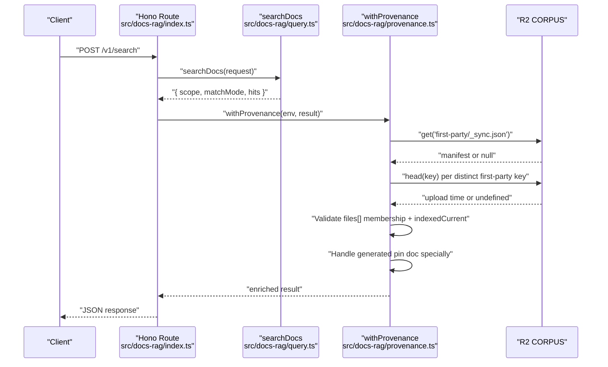

**Diagram sources**
- [index.ts:30-70](file://src/docs-rag/index.ts#L30-L70)
- [query.ts:120-200](file://src/docs-rag/query.ts#L120-L200)
- [provenance.ts:35-125](file://src/docs-rag/provenance.ts#L35-L125)

**Section sources**
- [index.ts:30-70](file://src/docs-rag/index.ts#L30-L70)
- [provenance.ts:35-125](file://src/docs-rag/provenance.ts#L35-L125)

## Detailed Component Analysis

### Sync Manifest Loader
`loadSyncManifest` reads `first-party/_sync.json` from the `CORPUS` R2 binding, parses JSON, validates it as an object, and caches the parsed value. It accepts an optional `now` argument so tests can control time.

- Cache lifetime: 5 minutes.
- Missing objects return `null`.
- Invalid JSON returns `null`.
- Non-object JSON (for example, an array) returns `null`.
- R2 errors return `null`.
- A reset helper clears the process-level cache.

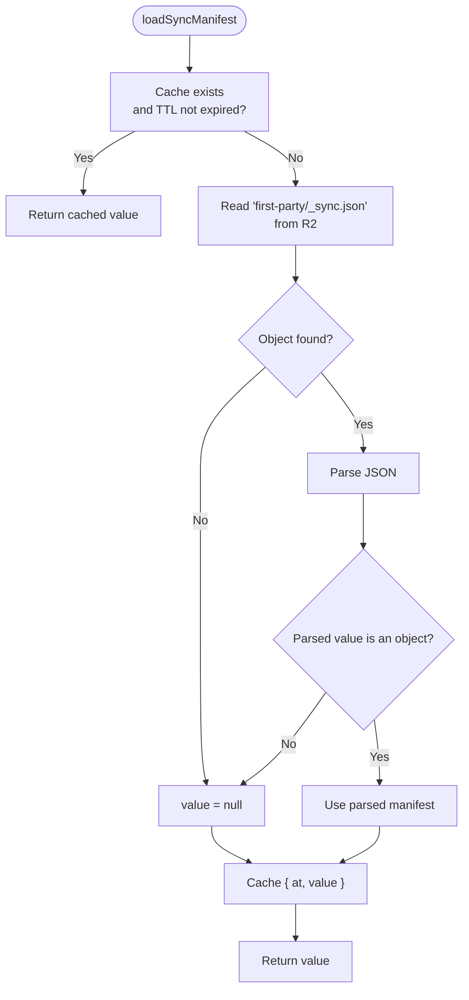

**Diagram sources**
- [provenance.ts:10-33](file://src/docs-rag/provenance.ts#L10-L33)

**Section sources**
- [provenance.ts:10-33](file://src/docs-rag/provenance.ts#L10-L33)

### Defensive Malformed Files Handling and Membership-Gated Freshness-Aware Commit Stamping
The provenance layer now applies strict validation to sync manifest fields and uses a dual-gate model to determine when commit information should be included. Items must both be present in the manifest's `files[]` array AND pass the freshness check based on timestamps.

**Updated** The `provenanceFor` function now takes an explicit `{ indexedAt, uploadedAt }` freshness argument and returns commit/dirty fields only through the combined membership and freshness gates. The implementation includes defensive handling for malformed `files` values:

| Gate | Requirement | Purpose |
|---|---|---|
| **Membership gate** | Key must exist in `sync.files[]` where `Array.isArray(sync?.files)` is true | Prevents retained/deleted R2 objects from falsely claiming a commit and handles non-array/string `files` values gracefully |
| **Freshness gate** | `indexedCurrent(indexedAt, uploadedAt)` must be true | Ensures indexed bytes match the synced commit |
| **Validation gate** | Commit must be non-empty string, dirty must be exactly `true` | Ensures type safety and prevents malformed data exposure |

**Updated** The defensive handling covers three malformed scenarios:
- **Non-array `files`**: Objects like `{}` or numbers don't throw errors but provide no membership
- **String `files`**: Single strings are treated as invalid arrays with no membership  
- **Missing `files`**: Absent arrays default to no membership checks

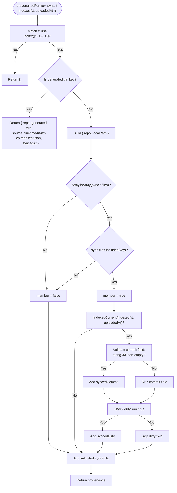

**Diagram sources**
- [provenance.ts:35-108](file://src/docs-rag/provenance.ts#L35-L108)

**Section sources**
- [provenance.ts:35-108](file://src/docs-rag/provenance.ts#L35-L108)

### Dirty Working Tree Flag Support
The `syncedDirty` flag indicates when a corpus was synced from a working tree with uncommitted changes. This flag is handled independently from the commit field, allowing dirty status to be reported even when commit information is unavailable.

**Updated** The `commitFields` function validates and extracts both commit and dirty fields:
- `syncedCommit`: Only included when `state.commit` is a non-empty string
- `syncedDirty`: Only included when `state.dirty === true` (exact boolean comparison)
- Both fields are validated defensively to prevent malformed data exposure

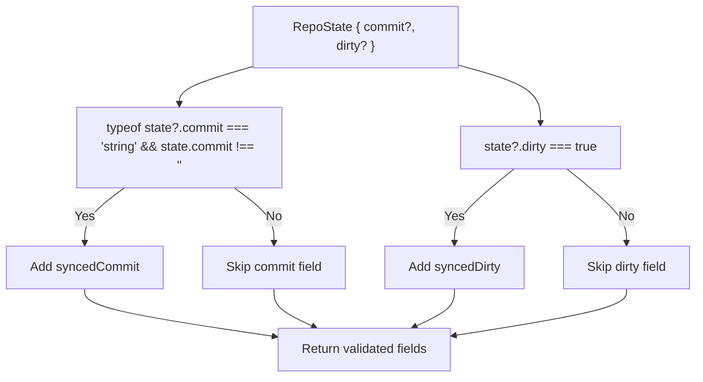

**Diagram sources**
- [provenance.ts:54-61](file://src/docs-rag/provenance.ts#L54-L61)

**Section sources**
- [provenance.ts:54-61](file://src/docs-rag/provenance.ts#L54-L61)

### Generated Pin Doc Special Handling
The generated pin document (`first-party/trackdub/docs/reference/docs-rag-pin.md`) receives special treatment in the provenance layer. Instead of returning a checkout path like other first-party documents, it returns metadata indicating it was generated at runtime.

**Updated** The `generatedFields` function creates provenance for the generated pin doc:
- Sets `generated: true` to indicate runtime generation.
- Uses `source: "runtime/trt-rtx-ep.manifest.json"` instead of a git checkout path.
- Includes `syncedAt` when available from the manifest.
- Extracts the repo name from the path structure.

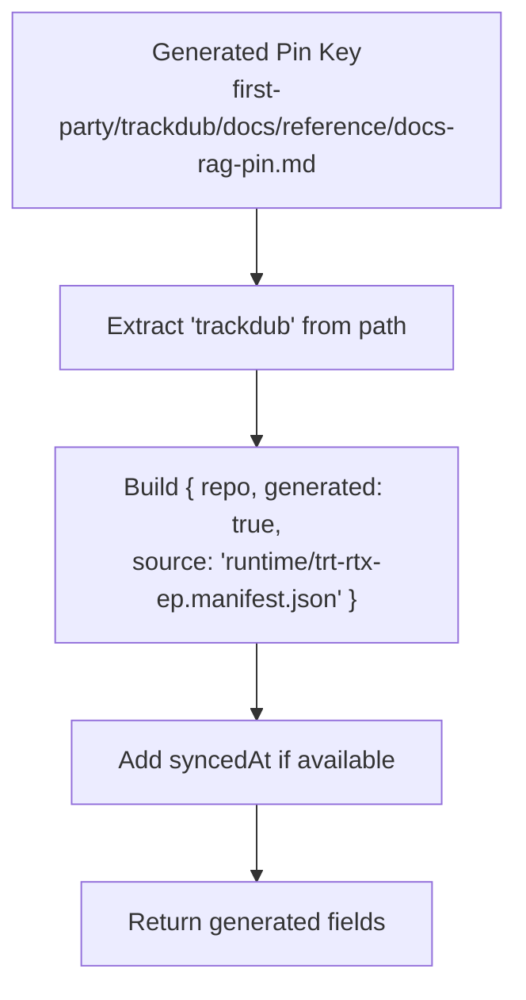

**Diagram sources**
- [provenance.ts:67-71](file://src/docs-rag/provenance.ts#L67-L71)

**Section sources**
- [provenance.ts:67-71](file://src/docs-rag/provenance.ts#L67-L71)
- [pin.generated.ts:1-9](file://src/docs-rag/pin.generated.ts#L1-L9)

### Result Enrichment Wrapper
`withProvenance` is the integration point used by both `/v1/search` and `/v1/ask`. It now performs per-key R2 HEAD requests to determine object upload times and caches those promises to avoid duplicate requests.

**Updated** The wrapper now:

1. Loads the sync manifest once per request.
2. Creates an `uploads` Map to cache HEAD request promises per distinct key.
3. Filters out the manifest hit identified by `SYNC_KEY`.
4. For each remaining hit, calls `CORPUS.head` once per distinct first-party key.
5. Maps every hit through `provenanceFor` with the computed freshness data.
6. Returns the original envelope with enriched `hits`.
7. Degrades gracefully when HEAD requests fail (returns undefined upload time).

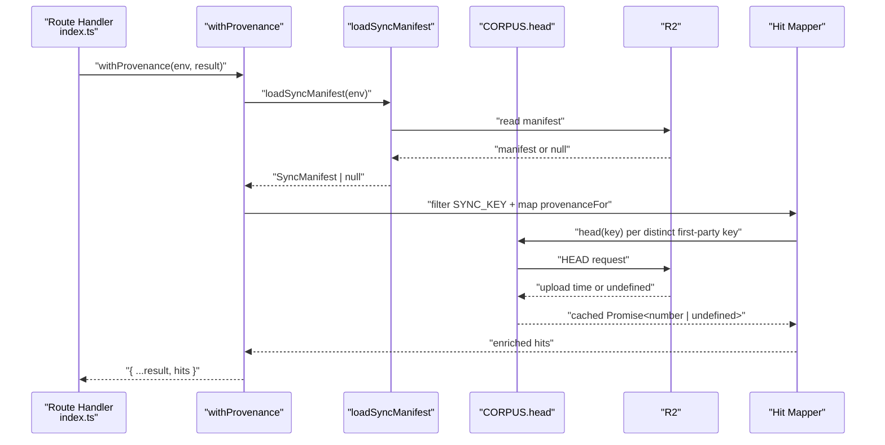

**Diagram sources**
- [index.ts:42-65](file://src/docs-rag/index.ts#L42-L65)
- [provenance.ts:85-125](file://src/docs-rag/provenance.ts#L85-L125)

**Section sources**
- [index.ts:42-65](file://src/docs-rag/index.ts#L42-L65)
- [provenance.ts:85-125](file://src/docs-rag/provenance.ts#L85-L125)

### Type Model
The component reuses the shared `DocsRagBindings` type to access `CORPUS`. The manifest model is intentionally minimal with strict field validation:

**Updated** The `SyncManifest` interface now includes a `files` field with defensive handling:

| Field | Meaning | Validation |
|---|---|---|
| `files` | Every key the sync staged; required for commit stamping | Must be string array for membership checks; non-array values treated as no membership |
| `syncedAt` | ISO timestamp when the corpus was synced. Optional. | Must be non-empty string |
| `repos` | Mapping from repository slug to commit metadata. Optional. | Must be object |
| `repos.<repo>.commit` | Git commit SHA used to build the corpus. May be null. | Must be non-empty string to include |
| `repos.<repo>.dirty` | Whether the source tree had uncommitted changes. May be null. | Must be exactly `true` to include |

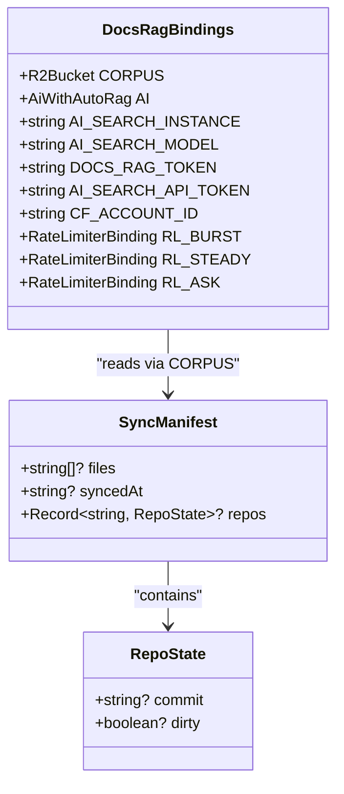

**Diagram sources**
- [provenance.ts:6-13](file://src/docs-rag/provenance.ts#L6-L13)
- [types.ts:80-113](file://src/docs-rag/types.ts#L80-L113)

**Section sources**
- [provenance.ts:6-13](file://src/docs-rag/provenance.ts#L6-L13)
- [types.ts:80-113](file://src/docs-rag/types.ts#L80-L113)

### Integration with the Search Pipeline
The search pipeline in `query.ts` produces `DocsRagSearchResult` objects whose `chunks` are converted into hits with `score`, `key`, and truncated `text`. Provenance operates on this output after AI Search has already ranked and merged results. This separation is important: provenance is presentation-layer metadata, not relevance logic.

**Updated** Route-level integration tests verify that first-party hits are stamped and the sync manifest chunk is never returned in `/v1/search` responses.

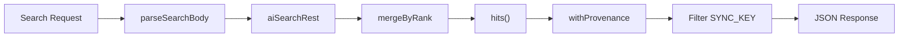

**Diagram sources**
- [query.ts:20-118](file://src/docs-rag/query.ts#L20-L118)
- [index.ts:42-65](file://src/docs-rag/index.ts#L42-L65)
- [docs-rag-provenance.test.ts:47-77](file://test/docs-rag-provenance.test.ts#L47-L77)

**Section sources**
- [query.ts:20-118](file://src/docs-rag/query.ts#L20-L118)
- [index.ts:42-65](file://src/docs-rag/index.ts#L42-L65)
- [docs-rag-provenance.test.ts:47-77](file://test/docs-rag-provenance.test.ts#L47-L77)

### Pin Text and Scope Context
Although not part of the provenance data model, the test suite verifies that the system prompt contains the generated pin sentence and excludes superseded pins. This ensures the answer model knows the pinned version context while relying on provenance for source attribution.

**Updated** The generated pin content comes from `pin.generated.ts` and is embedded in the system prompt through the `PIN_SENTENCE` constant.

**Section sources**
- [scopes.ts:1-84](file://src/docs-rag/scopes.ts#L1-L84)
- [pin.generated.ts:1-9](file://src/docs-rag/pin.generated.ts#L1-L9)
- [docs-rag-provenance.test.ts:18-35](file://test/docs-rag-provenance.test.ts#L18-L35)

### MCP Tool Error Handling
Both MCP tools (`search_trackdub_docs` and `ask_trackdub_docs`) now use consistent error handling through the `failureResult` function. Rate limit errors produce the same retryable response shape across all endpoints, providing uniform client experience.

**Updated** The MCP ask tool now returns the same retryable rate-limit response shape as search:

| Tool | Success Response | Rate Limit Response | Error Response |
|---|---|---|---|
| `search_trackdub_docs` | `textResult(result)` | `errorResult("rate limited: too many requests. Retry after ~10s.")` | `errorResult(error.message)` |
| `ask_trackdub_docs` | `textResult(result)` | `errorResult("rate limited: too many requests. Retry after ~10s.")` | `errorResult(error.message)` |

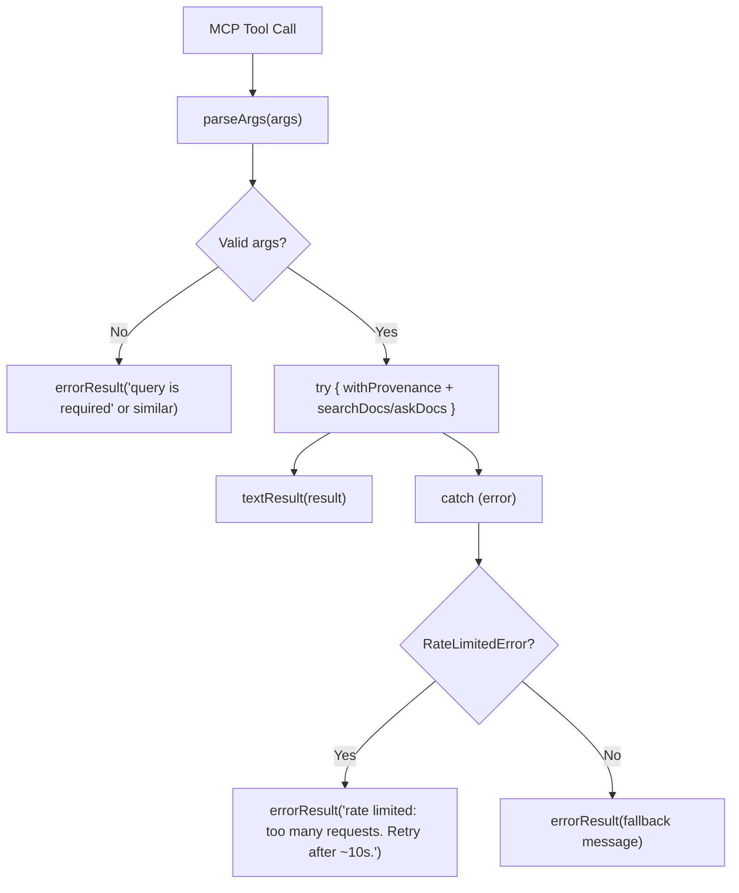

**Diagram sources**
- [mcp.ts:26-155](file://src/docs-rag/mcp.ts#L26-L155)

**Section sources**
- [mcp.ts:26-155](file://src/docs-rag/mcp.ts#L26-L155)

## Dependency Analysis
The provenance layer has a small, intentional dependency graph:

- `provenance.ts` depends on `types.ts` for `DocsRagBindings`.
- `index.ts` imports `withProvenance` and applies it to search and ask results.
- `query.ts` remains unaware of provenance; it returns plain result envelopes.
- `scopes.ts` defines scope constants and the system prompt; it is independent of provenance but references `pin.generated.ts`.
- `corpus.ts` is unrelated to provenance but shares the same R2-based corpus domain.
- `mcp.ts` uses `withProvenance` for both search and ask tools with consistent error handling.
- `pin.generated.ts` provides generated pin information used by the system prompt.

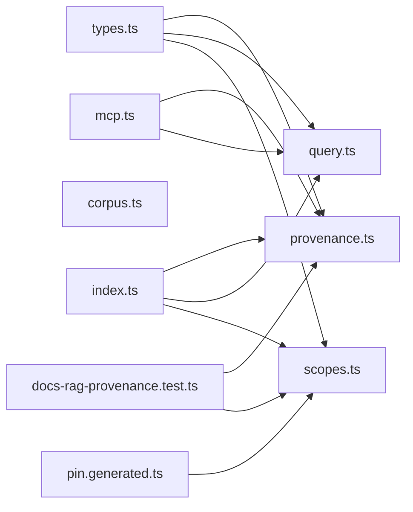

**Diagram sources**
- [provenance.ts:1-2](file://src/docs-rag/provenance.ts#L1-L2)
- [index.ts:1-10](file://src/docs-rag/index.ts#L1-L10)
- [query.ts:1-6](file://src/docs-rag/query.ts#L1-L6)
- [scopes.ts:1-3](file://src/docs-rag/scopes.ts#L1-L3)
- [mcp.ts:1-8](file://src/docs-rag/mcp.ts#L1-L8)
- [pin.generated.ts:1-2](file://src/docs-rag/pin.generated.ts#L1-L2)
- [docs-rag-provenance.test.ts:1-12](file://test/docs-rag-provenance.test.ts#L1-L12)

**Section sources**
- [provenance.ts:1-2](file://src/docs-rag/provenance.ts#L1-L2)
- [index.ts:1-10](file://src/docs-rag/index.ts#L1-L10)
- [query.ts:1-6](file://src/docs-rag/query.ts#L1-L6)
- [scopes.ts:1-3](file://src/docs-rag/scopes.ts#L1-L3)
- [mcp.ts:1-8](file://src/docs-rag/mcp.ts#L1-L8)
- [pin.generated.ts:1-2](file://src/docs-rag/pin.generated.ts#L1-L2)
- [docs-rag-provenance.test.ts:1-12](file://test/docs-rag-provenance.test.ts#L1-L12)

## Performance Considerations
- **Manifest cache**: The in-process cache avoids repeated R2 reads within a five-minute window.
- **Per-key HEAD caching**: `withProvenance` uses an `uploads` Map to cache HEAD request promises, ensuring each distinct first-party key triggers only one R2 HEAD call even when multiple chunks come from the same object.
- **Single manifest read per request**: `withProvenance` loads the manifest once even though it may stamp many hits.
- **Minimal parsing overhead**: JSON parsing happens only when the object exists and is within the cache miss window.
- **No impact on search latency**: Provenance runs after AI Search retrieval and ranking.
- **Memory footprint**: The cache holds one parsed manifest plus its timestamp; the uploads Map stores promises per distinct key.
- **Key parsing cost**: Regular expression matching occurs once per hit; keys are short strings derived from R2 paths.
- **Validation efficiency**: Strict field validation prevents unnecessary property assignment and reduces payload size.
- **Graceful degradation**: Failed HEAD requests return undefined upload times, allowing partial provenance without breaking the search.
- **Membership check optimization**: Array membership check (`files.includes`) is O(n) but manifests are expected to be small.
- **Defensive array checking**: `Array.isArray(sync?.files)` prevents type errors when `files` is malformed.

[No sources needed since this section provides general guidance]

## Troubleshooting Guide

### Symptom: No provenance fields appear on first-party hits
Check whether the key matches `first-party/<repo>/<path>`. Keys without this structure—such as vendor paths or `null`—receive no provenance fields by design. Also verify that the manifest exists and includes the expected repository slug under `repos`.

**Updated** Additionally, ensure the key exists in the manifest's `files[]` array AND that `Array.isArray(sync?.files)` returns true. Retained or deleted R2 objects that are not listed in `files`, or manifests with malformed `files` values (objects, strings, or missing), will not receive commit stamps, preventing false provenance claims.

**Section sources**
- [provenance.ts:35-51](file://src/docs-rag/provenance.ts#L35-L51)
- [provenance.ts:71-77](file://src/docs-rag/provenance.ts#L71-L77)

### Symptom: Manifest reads never stop after deployment
Verify that `resetSyncManifestCache()` is called in tests or other controlled environments where stale process-level state matters. In normal Worker invocations, the cache is process-scoped and refreshed automatically after the TTL expires.

**Section sources**
- [provenance.ts:14-17](file://src/docs-rag/provenance.ts#L14-L17)
- [docs-rag-provenance.test.ts:15-17](file://test/docs-rag-provenance.test.ts#L15-L17)

### Symptom: Errors reading the manifest break searches
Missing manifests, invalid JSON, non-object payloads, and R2 failures all degrade to `null`. The search continues without provenance stamps rather than failing. If upstream R2 is unavailable, inspect logs around the R2 read path and confirm the `CORPUS` binding is configured correctly.

**Section sources**
- [provenance.ts:19-33](file://src/docs-rag/provenance.ts#L19-L33)
- [docs-rag-provenance.test.ts:76-93](file://test/docs-rag-provenance.test.ts#L76-L93)

### Symptom: The sync manifest appears in search results
The manifest key `first-party/_sync.json` is explicitly filtered out by `withProvenance`. If it still appears, ensure the route handler uses `withProvenance` around the search result and that custom code is not bypassing this wrapper.

**Section sources**
- [provenance.ts:53-67](file://src/docs-rag/provenance.ts#L53-L67)
- [index.ts:42-65](file://src/docs-rag/index.ts#L42-L65)

### Symptom: Dirty flag is missing or incorrect
A dirty flag is added only when the manifest's repository entry has `dirty === true` (exact boolean comparison). A null, undefined, or non-boolean `dirty` field does not set `syncedDirty`. Verify the manifest produced by the corpus sync tool and ensure the repository was synced from a working tree with uncommitted changes.

**Updated** The dirty flag is validated defensively and only included when the exact boolean `true` is provided, preventing malformed data exposure.

**Section sources**
- [provenance.ts:54-61](file://src/docs-rag/provenance.ts#L54-L61)
- [docs-rag-provenance.test.ts:41-45](file://test/docs-rag-provenance.test.ts#L41-L45)

### Symptom: Commit field is missing despite having a valid manifest
The commit field now requires two conditions: the key must be present in the manifest's `files[]` array AND the item must have been indexed after its object was uploaded (via `indexedCurrent`). If either condition fails, the commit field is omitted.

**Updated** Malformed fields are now silently dropped rather than propagated to clients, ensuring type safety and preventing invalid data exposure. The freshness model ensures commit information is only shown when the indexed bytes match the synced commit AND the file is listed in the manifest's `files[]` array. Additionally, malformed `files` values (non-arrays, strings, or missing) are treated as no membership, preventing any commit stamps.

**Section sources**
- [provenance.ts:57-77](file://src/docs-rag/provenance.ts#L57-L77)
- [docs-rag-provenance.test.ts:108-117](file://test/docs-rag-provenance.test.ts#L108-L117)

### Symptom: Malformed files values cause unexpected behavior
If the sync manifest contains malformed `files` values (objects, strings, or arrays of non-strings), the system treats them as having no membership rather than throwing errors. This defensive approach ensures search functionality continues even with corrupted manifest data.

**Updated** The implementation uses `Array.isArray(sync?.files)` to safely handle malformed values. Non-array `files` values result in no membership, preventing false commit stamps while maintaining system stability.

**Section sources**
- [provenance.ts:83-84](file://src/docs-rag/provenance.ts#L83-L84)
- [docs-rag-provenance.test.ts:83-92](file://test/docs-rag-provenance.test.ts#L83-L92)

### Symptom: Generated pin doc shows wrong source path
The generated pin doc (`first-party/trackdub/docs/reference/docs-rag-pin.md`) should return `generated: true` and `source: "runtime/trt-rtx-ep.manifest.json"` instead of a git checkout path. If you see a different behavior, check that the key matches the exact generated pin path pattern.

**Updated** The generated pin doc receives special handling to distinguish it from regular first-party documents.

**Section sources**
- [provenance.ts:67-71](file://src/docs-rag/provenance.ts#L67-L71)
- [docs-rag-provenance.test.ts:37-43](file://test/docs-rag-provenance.test.ts#L37-L43)

### Symptom: MCP ask tool behaves differently than search
Both MCP tools now use consistent error handling through `failureResult`. Rate limit errors return the same retryable response shape: `errorResult("rate limited: too many requests. Retry after ~10s.")`. This provides uniform client experience across both search and ask operations.

**Updated** The MCP ask tool now returns the same retryable rate-limit response shape as search, using failureResult for both endpoints.

**Section sources**
- [mcp.ts:26-155](file://src/docs-rag/mcp.ts#L26-L155)

### Symptom: R2 HEAD requests are being made too frequently
Each distinct first-party key should trigger only one HEAD request due to the `uploads` Map caching. If you see duplicate HEAD calls for the same key, check whether multiple instances of `withProvenance` are running in separate processes or workers, as the cache is process-local.

**Updated** The `uploads` Map caches HEAD request promises per distinct key within a single `withProvenance` invocation, ensuring efficient batch processing of multiple chunks from the same object.

**Section sources**
- [provenance.ts:85-125](file://src/docs-rag/provenance.ts#L85-L125)

### Symptom: Route-level integration tests fail
Route-level integration tests verify that first-party hits are stamped and the sync manifest chunk is never returned in `/v1/search` responses. Ensure the test environment properly mocks R2 responses and that the Hono app is correctly wired with `withProvenance`.

**Section sources**
- [docs-rag-provenance.test.ts:47-77](file://test/docs-rag-provenance.test.ts#L47-L77)

## Conclusion
The first-party provenance layer adds lightweight, reliable source attribution to Docs RAG search results without altering relevance logic. It treats the R2 sync manifest as best-effort metadata, degrades safely when unavailable, and integrates cleanly into the existing Hono route handlers. Recent enhancements include defensive handling of malformed `files` values that prevents system crashes while maintaining security, explicit `syncedDirty` flag support for dirty working trees, strict dual-gate validation requiring both manifest membership and index freshness before commit stamping, generated pin doc special handling with runtime source attribution, per-key R2 HEAD request caching for performance, stricter field validation that silently drops malformed data, and consistent error handling across MCP tools. Tests provide confidence across caching, filtering, error cases, malformed field handling, membership requirements, dirty tree scenarios, and the final enrichment contract.