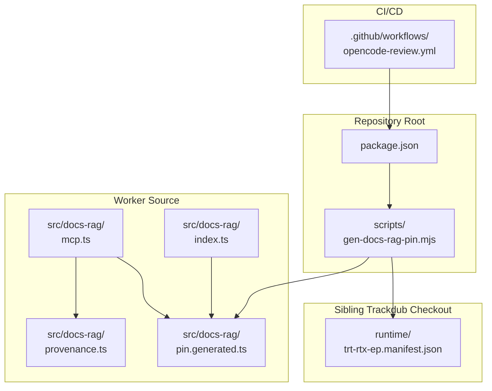
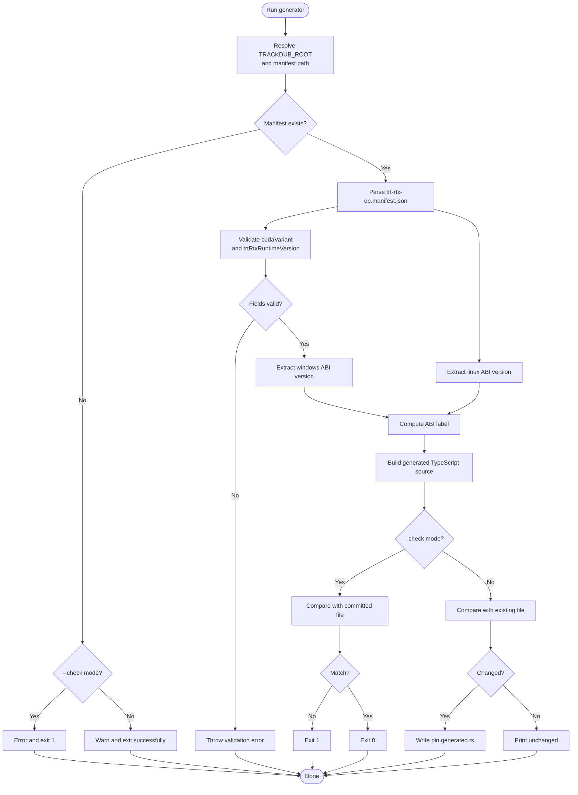
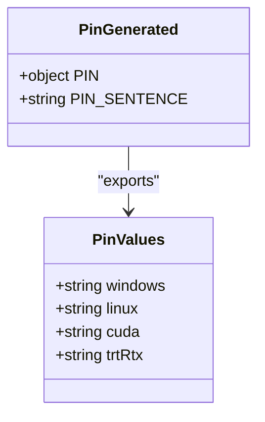
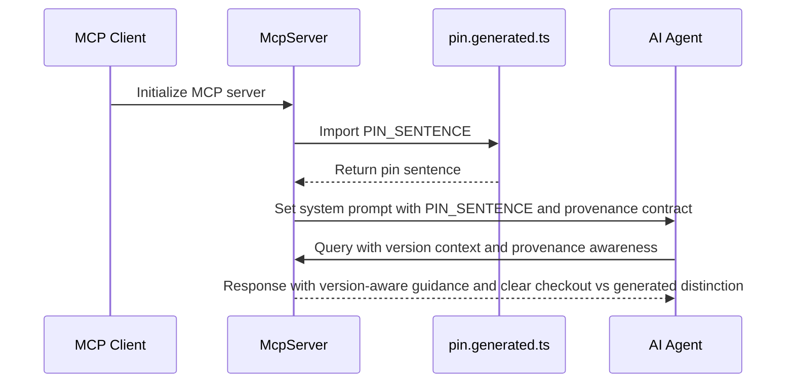
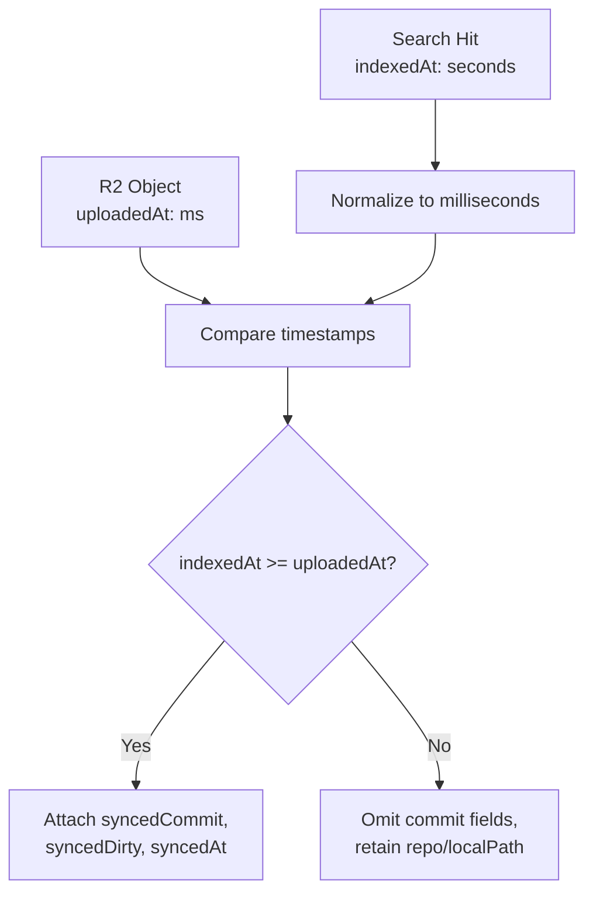
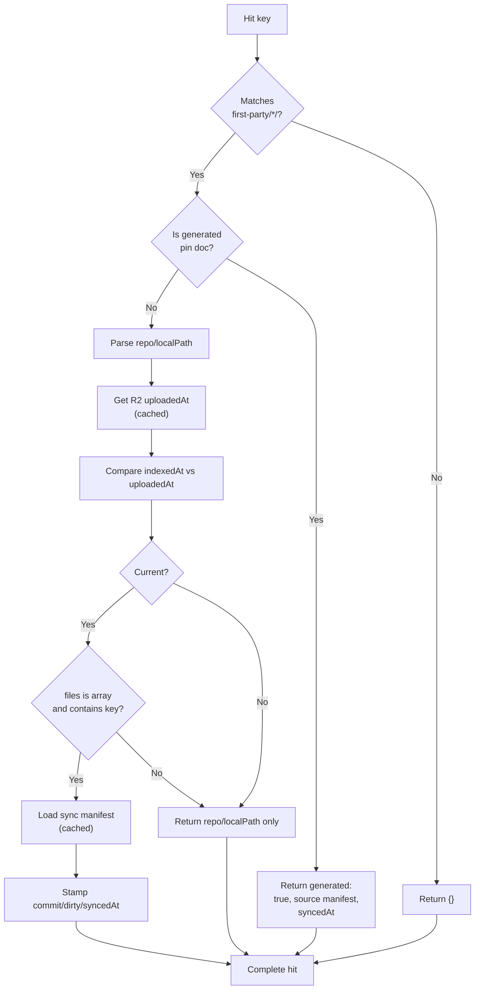
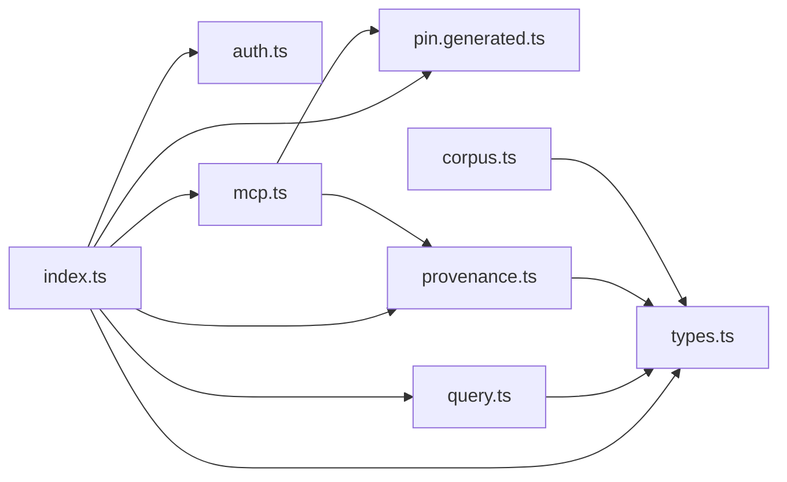
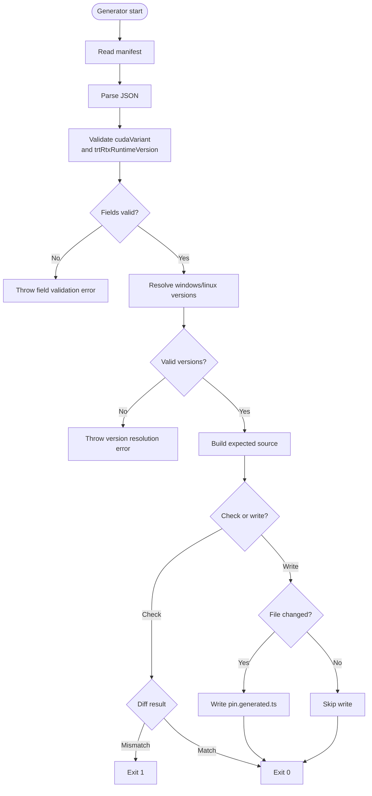

# Docs RAG Pin Generation

<cite>
**Referenced Files in This Document**
- [gen-docs-rag-pin.mjs](file://scripts/gen-docs-rag-pin.mjs)
- [pin.generated.ts](file://src/docs-rag/pin.generated.ts)
- [mcp.ts](file://src/docs-rag/mcp.ts)
- [provenance.ts](file://src/docs-rag/provenance.ts)
- [index.ts](file://src/docs-rag/index.ts)
- [package.json](file://package.json)
- [opencode-review.yml](file://.github/workflows/opencode-review.yml)
- [docs-rag-provenance.test.ts](file://test/docs-rag-provenance.test.ts)
</cite>

## Update Summary
**Changes Made**
- Updated provenance system section to document stricter manifest `files` validation with graceful degradation for non-array values.
- Enhanced dirty-tree stamp behavior documentation to clarify `syncedDirty: true` semantics when `dirty: true` in sync manifests.
- Updated MCP server integration section with clarified provenance contract that distinguishes checkout files from generated hits.
- Added comprehensive test coverage documentation for malformed manifest field handling and degraded behavior modes.

## Table of Contents
1. [Introduction](#introduction)
2. [Purpose and Scope](#purpose-and-scope)
3. [Project Structure](#project-structure)
4. [Pin Generator Workflow](#pin-generator-workflow)
5. [Generated Artifact Contract](#generated-artifact-contract)
6. [MCP Server Integration](#mcp-server-integration)
7. [Provenance System](#provenance-system)
8. [Runtime Usage](#runtime-usage)
9. [Developer Commands](#developer-commands)
10. [Environment Variables](#environment-variables)
11. [Error Handling and Failure Modes](#error-handling-and-failure-modes)
12. [CI and Review Workflows](#ci-and-review-workflows)
13. [Troubleshooting Guide](#troubleshooting-guide)
14. [Conclusion](#conclusion)

## Introduction
The Docs RAG pin generation system ensures that the Trackdub API Worker's documentation retrieval runtime uses TensorRT-RTX execution provider versions that match the bundle shipped by the sibling Trackdub repository. It consists of:

- A Node.js build-time script at `scripts/gen-docs-rag-pin.mjs`.
- A generated TypeScript module at `src/docs-rag/pin.generated.ts`.
- MCP server integration that embeds the generated `PIN_SENTENCE` into system instructions.
- A sophisticated provenance system that attaches commit metadata to search results based on per-object freshness and sync-manifest membership.
- NPM scripts that run the generator before development and deployment of the docs-rag Worker.

This document explains how the generator reads version metadata from a Trackdub checkout, what it writes, how the Worker consumes the artifact, and how to keep it in sync.

## Purpose and Scope
Trackdub ships a runtime bundle containing platform-specific TensorRT-RTX EP artifacts. The agent runtime inside the Worker must load the same ABI and CUDA/TensorRT-RTX versions as that bundle; otherwise agents may fail at startup or behave inconsistently across platforms.

The pin generator solves this by:

- Reading `runtime/trt-rtx-ep.manifest.json` from a Trackdub checkout (default `../Trackdub`, configurable via `TRACKDUB_ROOT`).
- Validating required manifest fields (`cudaVariant`, `trtRtxRuntimeVersion`) before generating output.
- Extracting Windows and Linux ABI versions, CUDA variant, and TensorRT-RTX runtime version.
- Writing a TypeScript module exporting both structured pins and a human-readable sentence describing them.
- Embedding the generated `PIN_SENTENCE` into the MCP server system prompt for agent guidance.
- Supporting a check mode so CI or developers can detect stale pins without mutating files.

**Scope boundaries:**
- The generator is a Node.js tool; it does not run inside Cloudflare Workers.
- The generated file is consumed by the Worker at runtime but contains no network calls.
- This document covers only the pin generator and its immediate artifact. It does not describe corpus synchronization, MCP routing, search/ask endpoints, or authentication beyond identifying where the generated pin is located.

**Section sources**
- [gen-docs-rag-pin.mjs:1-68](file://scripts/gen-docs-rag-pin.mjs#L1-L68)
- [pin.generated.ts:1-9](file://src/docs-rag/pin.generated.ts#L1-L9)

## Project Structure
The relevant layout for this feature is small and focused:

**Diagram sources**
- [gen-docs-rag-pin.mjs:1-68](file://scripts/gen-docs-rag-pin.mjs#L1-L68)
- [pin.generated.ts:1-9](file://src/docs-rag/pin.generated.ts#L1-L9)
- [mcp.ts:1-155](file://src/docs-rag/mcp.ts#L1-L155)
- [provenance.ts:1-125](file://src/docs-rag/provenance.ts#L1-L125)
- [index.ts:1-90](file://src/docs-rag/index.ts#L1-L90)
- [opencode-review.yml:1-31](file://.github/workflows/opencode-review.yml#L1-L31)
- [package.json:1-73](file://package.json#L1-L73)

## Pin Generator Workflow
The generator is invoked with Node.js and supports two modes:

| Invocation | Behavior |
|---|---|
| `node scripts/gen-docs-rag-pin.mjs` | Reads the manifest and writes `src/docs-rag/pin.generated.ts` if the content would change. |
| `node scripts/gen-docs-rag-pin.mjs --check` | Compares the committed generated file with the expected output and exits with status 1 when they differ. |

### Input Resolution
The manifest path is resolved as follows:

1. Start from the script's directory (`scripts/`).
2. Resolve the parent directory as `root`.
3. Use `TRACKDUB_ROOT` if set.
4. Otherwise default to `../Trackdub`.
5. Append `runtime/trt-rtx-ep.manifest.json`.

If the manifest does not exist:

- In write mode, the generator logs a warning and exits successfully without modifying the generated file.
- In `--check` mode, it logs an error indicating that the committed pin cannot be verified and exits with status 1.

This allows development to continue even when the sibling Trackdub checkout is missing, while still letting CI gate on a deliberately configured external checkout.

### Manifest Field Validation
**Updated** The generator now performs strict validation of critical manifest fields before proceeding:

- `cudaVariant`: Must be a non-empty string (e.g., `"cu13"`).
- `trtRtxRuntimeVersion`: Must be a non-empty string (e.g., `"1.7.1"`).

These validations occur immediately after parsing the manifest, ensuring that incomplete or malformed manifests fail fast rather than producing partial or undefined pins.

### Version Extraction Logic
For each platform, the generator looks under `manifest.packages[platform].archiveUrl` and extracts the semantic version segment after `/v`. If that pattern is absent, it falls back to `manifest.version`.

It then computes:

- `windows`: the extracted Windows ABI version.
- `linux`: the extracted Linux ABI version.
- `abi`: a human-readable label indicating whether Windows and Linux share the same ABI or differ.
- `cuda`: the validated CUDA variant from `manifest.cudaVariant`.
- `trtRtx`: the validated TensorRT-RTX runtime version from `manifest.trtRtxRuntimeVersion`.

If neither the archive URL nor the fallback version resolves for a platform, the generator throws an error rather than silently generating a partial pin.

### Output Decision
After constructing the expected source text, the generator compares it with any existing generated file:

- In `--check` mode, a mismatch causes exit code 1.
- In write mode, a mismatch writes the new file.
- If the files are identical, it prints an unchanged message.

**Diagram sources**
- [gen-docs-rag-pin.mjs:10-68](file://scripts/gen-docs-rag-pin.mjs#L10-L68)

**Section sources**
- [gen-docs-rag-pin.mjs:1-68](file://scripts/gen-docs-rag-pin.mjs#L1-L68)

## Generated Artifact Contract
The generated file exports two constants:

| Export | Type | Meaning |
|---|---|---|
| `PIN` | `readonly object` | Structured pin values for `windows`, `linux`, `cuda`, and `trtRtx`. |
| `PIN_SENTENCE` | `string` | Human-readable sentence summarizing the pinned ABI, CUDA, and TensorRT-RTX versions. |

Example current values (from the repository snapshot):

- `PIN.windows`: `"0.5.0"`
- `PIN.linux`: `"0.5.0"`
- `PIN.cuda`: `"cu13"`
- `PIN.trtRtx`: `"1.7.1"`
- `PIN_SENTENCE`: Indicates shared ABI 0.5.0, CUDA cu13, and TensorRT-RTX 1.7.1.

Because the file is generated, it should never be edited manually. Any manual edits will be overwritten unless the underlying manifest changes.

**Diagram sources**
- [pin.generated.ts:1-9](file://src/docs-rag/pin.generated.ts#L1-L9)

**Section sources**
- [pin.generated.ts:1-9](file://src/docs-rag/pin.generated.ts#L1-L9)

## MCP Server Integration
**Updated Section** The generated `PIN_SENTENCE` is now embedded directly into the MCP server's system instructions, providing agents with immediate context about the pinned TensorRT-RTX versions and clarified provenance contracts.

The MCP server is created in `src/docs-rag/mcp.ts` and includes the pin information as part of its instructional context:

- The system prompt concatenates the full `PIN_SENTENCE` value alongside other operational instructions.
- Agents receive guidance to prefer `search_trackdub_docs`, use `ask_trackdub_docs` only for synthesized answers, and verify version numbers against cited hits.
- **Updated** The provenance contract explicitly distinguishes between checkout files and generated hits: first-party hits carry `repo` and `localPath`, while generated hits have `generated: true` and no checkout file.
- **Updated** The contract clarifies that `syncedCommit` appears only when the indexed copy matches the commit, and `syncedDirty: true` indicates uncommitted changes were present during sync.
- The pin information helps agents understand the specific TensorRT-RTX EP ABI and CUDA versions being used.
- The test suite asserts that `SYSTEM_PROMPT` contains the generated pin sentence and that superseded static pin values are no longer present.

**Diagram sources**
- [mcp.ts:1-155](file://src/docs-rag/mcp.ts#L1-L155)
- [pin.generated.ts:1-9](file://src/docs-rag/pin.generated.ts#L1-L9)

**Section sources**
- [mcp.ts:1-155](file://src/docs-rag/mcp.ts#L1-L155)
- [pin.generated.ts:1-9](file://src/docs-rag/pin.generated.ts#L1-L9)

## Provenance System
**Updated Section** The provenance system enriches search results with commit metadata and repository location information, but only when the indexed content is fresh enough to match the synced corpus. The system now features stricter validation and clearer contract definitions.

### Core Concept: Per-Object Freshness Gates
The key innovation is that `syncedCommit` and `syncedDirty` fields are attached **only** when a hit's `indexedAt` timestamp is at or after that specific object's R2 `uploadedAt` timestamp. This is fundamentally different from simply checking whether a sync manifest exists.

The rationale: an unchanged R2 object retains its old upload time even if the corpus was re-synced later. Therefore, an index entry older than the object's upload time cannot guarantee that the bytes at that R2 key correspond to the synced commit — the object might have been replaced between indexing and syncing.

**Diagram sources**
- [provenance.ts:41-56](file://src/docs-rag/provenance.ts#L41-L56)

### Timestamp Normalization
AI Search indexes use inconsistent timestamp units: some indexes return seconds, others return milliseconds. The system normalizes all timestamps to milliseconds using a heuristic:

- Values less than `1e12` (January 2001 in milliseconds) are treated as seconds and multiplied by 1000.
- Values greater than or equal to `1e12` are treated as already being milliseconds.

This handles the edge case where a freshly indexed item arrives in seconds while its R2 object's `uploadedAt` is already in milliseconds.

### Sync Manifest Loading and Caching
The sync manifest is stored at the internal key `first-party/_sync.json` and describes which commit each repository was synced from, along with whether the tree was dirty. It is loaded once per request with a 5-minute cache window:

| Cache State | Behavior |
|---|---|
| Within TTL | Return cached manifest without reading R2. |
| Expired | Re-read `SYNC_KEY` from R2, parse JSON, validate structure, and cache result. |
| Missing/corrupt | Degrade to `null` — never fails the search. |

The manifest is intentionally filtered out from search results via the `SYNC_KEY` constant, preventing clients from seeing internal synchronization metadata.

### Stricter Manifest `files` Validation
**Updated** The system now validates the `files` array more strictly while maintaining graceful degradation:

- **Array values**: Normal processing proceeds with membership checks.
- **Non-array values** (objects, strings, null, etc.): Treated as no membership — the hit gets no commit stamp but retains location info.
- **Missing `files` property**: Same degradation — no commit stamp, location retained.

This prevents crashes from malformed manifests while ensuring that only clearly validated file lists can receive commit stamps.

### Dirty-Tree Stamp Behavior
**Updated** The dirty-tree stamp now has precise semantics:

- When `dirty: true` in the sync manifest's repo state, `syncedDirty: true` is attached to the provenance.
- The dirty flag is preserved even when the commit field is unavailable or null.
- When `dirty: false` or missing, no `syncedDirty` field is added.
- This allows agents to distinguish between clean syncs and syncs with uncommitted local changes.

### Generated-Document Stamping
A special case exists for the generated pin documentation itself. When the hit key matches `first-party/trackdub/docs/reference/docs-rag-pin.md`, the system returns a `generated: true` provenance record with `source: "runtime/trt-rtx-ep.manifest.json"` and the sync timestamp, rather than treating it as a regular first-party document.

This distinguishes auto-generated documentation from checked-in source material while still retaining sync provenance.

### Degraded Behavior Modes
When provenance stamping cannot be applied, the system degrades gracefully rather than failing:

| Condition | Behavior |
|---|---|
| Stale hit (`indexedAt < uploadedAt`) | Returns `repo` and `localPath` but omits `syncedCommit` and `syncedDirty`. |
| Missing `indexedAt` or `uploadedAt` | Same degradation — location info retained, commit omitted. |
| Malformed sync manifest | Treated as no manifest — commit/dirty fields omitted, `syncedAt` omitted. |
| Non-array `files` value | No membership — commit omitted, location retained. |
| Missing R2 object | HEAD call returns `undefined` — commit omitted, location retained. |
| Vendor or null key | No first-party mapping — empty provenance object. |
| Internal `_sync.json` key | Filtered out entirely from visible results. |
| R2 HEAD call throws | Caught and treated as missing upload time — commit omitted. |

**Diagram sources**
- [provenance.ts:58-125](file://src/docs-rag/provenance.ts#L58-L125)

### Data Structures
The provenance system operates on these core types:

| Type | Fields | Meaning |
|---|---|---|
| `SyncManifest` | `files?`, `syncedAt?`, `repos?` | Top-level sync metadata, indexed file list, and per-repo state. |
| Repo state | `commit?`, `dirty?` | Git commit SHA and whether the working tree had uncommitted changes. |
| `provenanceFor` input | `key`, `sync`, `freshness` | R2 key, parsed manifest, and `{indexedAt?, uploadedAt?}`. |
| `withProvenance` wrapper | Adds `repo`, `localPath`, optional `syncedCommit`, `syncedDirty`, `syncedAt` | Enriches search/ask results. |

### Test Coverage
**Updated** The test suite now validates the stricter validation behaviors:

- Fresh hits get `syncedCommit`, `syncedDirty`, and `syncedAt`.
- Stale hits retain `repo`/`localPath` but omit commit fields.
- Millisecond and second timestamps are handled equivalently.
- The generated pin documentation is stamped as generated with the manifest source.
- **Updated** Non-array `files` values degrade gracefully without throwing errors.
- **Updated** String `files` values provide no membership instead of causing errors.
- Deleted or non-member objects do not receive commit stamps.
- Vendor and null keys produce empty provenance objects.
- The internal `_sync.json` key is hidden from results.
- Multiple chunks from the same object trigger only one R2 HEAD call.
- R2 failures degrade gracefully without losing the hit.
- Malformed manifest fields are dropped rather than exposed.
- **Updated** Dirty-tree stamps (`syncedDirty: true`) are properly preserved even when commit is unavailable.

**Section sources**
- [provenance.ts:1-125](file://src/docs-rag/provenance.ts#L1-L125)
- [docs-rag-provenance.test.ts:1-260](file://test/docs-rag-provenance.test.ts#L1-L260)

## Runtime Usage
The generated file lives under `src/docs-rag/`, colocated with other docs-rag modules such as `corpus.ts`, `provenance.ts`, `query.ts`, `scopes.ts`, `auth.ts`, and `mcp.ts`. Its responsibilities are intentionally narrow:

- Provide compile-time and runtime access to pinned TensorRT-RTX EP versions.
- Provide a stable sentence useful for diagnostics, logging, developer-facing reports, and MCP system prompts.

The worker entry point `src/docs-rag/index.ts` defines health, MCP, search, and ask routes. Both `/v1/search` and `/v1/ask` wrap their responses through `withProvenance`, ensuring every returned hit carries enriched provenance data. The pin module is separate from request handling, which keeps version information available without coupling every route to the generator logic.

**Diagram sources**
- [index.ts:1-90](file://src/docs-rag/index.ts#L1-L90)
- [pin.generated.ts:1-9](file://src/docs-rag/pin.generated.ts#L1-L9)
- [mcp.ts:1-155](file://src/docs-rag/mcp.ts#L1-L155)
- [provenance.ts:1-125](file://src/docs-rag/provenance.ts#L1-L125)

**Section sources**
- [index.ts:1-90](file://src/docs-rag/index.ts#L1-L90)
- [pin.generated.ts:1-9](file://src/docs-rag/pin.generated.ts#L1-L9)
- [mcp.ts:1-155](file://src/docs-rag/mcp.ts#L1-L155)

## Developer Commands
The following NPM scripts integrate the generator into normal development workflows:

| Script | Command | Purpose |
|---|---|---|
| `gen:docs-rag-pin` | `node scripts/gen-docs-rag-pin.mjs` | Generate or update the pin file. |
| `check:docs-rag-pin` | `node scripts/gen-docs-rag-pin.mjs --check` | Validate that the committed pin matches the manifest. |
| `predev:docs-rag` | Runs `gen:docs-rag-pin` before `dev:docs-rag` | Ensures the dev Worker starts with an up-to-date pin. |
| `predeploy:docs-rag` | Runs `gen:docs-rag-pin` before `deploy:docs-rag` | Ensures deployments cannot ship a stale pin. |

Recommended usage:

- Run `npm run gen:docs-rag-pin` after updating the Trackdub checkout or its manifest.
- Run `npm run check:docs-rag-pin` in CI or before committing to enforce pin freshness.
- Do not bypass `predev:docs-rag` or `predeploy:docs-rag` unless you intentionally want to skip pin regeneration.

**Section sources**
- [package.json:1-73](file://package.json#L1-L73)

## Environment Variables
Only one environment variable affects the generator:

| Variable | Default | Description |
|---|---|---|
| `TRACKDUB_ROOT` | `../Trackdub` relative to the repository root | Path to the sibling Trackdub checkout containing `runtime/trt-rtx-ep.manifest.json`. |

The generator resolves the manifest path using Node's path resolution and `process.env.TRACKDUB_ROOT`. It does not read secrets, configuration from D1, or runtime bindings; it runs outside the Worker lifecycle.

**Section sources**
- [gen-docs-rag-pin.mjs:10-22](file://scripts/gen-docs-rag-pin.mjs#L10-L22)

## Error Handling and Failure Modes
The generator distinguishes between recoverable and non-recoverable conditions:

| Condition | Behavior |
|---|---|
| Manifest file missing | Logs a warning and exits successfully in write mode; in `--check` mode, logs an error and exits with status 1. This preserves the previously committed pin and allows development without the sibling checkout. |
| Missing or invalid `cudaVariant` field | Throws an error requiring a non-empty string value. |
| Missing or invalid `trtRtxRuntimeVersion` field | Throws an error requiring a non-empty string value. |
| Cannot resolve ABI version for a platform | Throws an error because pinning requires explicit version information. |
| Generated file differs from expected output in `--check` mode | Exits with status 1, suitable for CI failure. |
| Generated file differs in write mode | Overwrites `src/docs-rag/pin.generated.ts` and logs success. |
| Generated file is already up to date | Prints an unchanged or up-to-date message and exits successfully. |

Important design notes:

- Missing manifest is **not** a hard failure in write mode. This avoids blocking development when the sibling checkout is absent.
- Invalid manifest fields (`cudaVariant`, `trtRtxRuntimeVersion`) are **hard failures**. This prevents partial or malformed pins from being generated.
- Missing version data **is** a hard failure. A partial pin could silently select wrong binaries.
- The generator treats the generated file as canonical once written; manual drift is corrected by rerunning the generator or failing CI.

**Diagram sources**
- [gen-docs-rag-pin.mjs:24-68](file://scripts/gen-docs-rag-pin.mjs#L24-L68)

**Section sources**
- [gen-docs-rag-pin.mjs:24-68](file://scripts/gen-docs-rag-pin.mjs#L24-L68)

## CI and Review Workflows
**Updated Section** The CI review workflow has been updated to use current model configurations for automated code review tasks.

The OpenCode review workflow now uses:

- `cf:@cf/zai-org/glm-5.3` for review tasks (replacing the unavailable `glm-5.2`).
- Multiple models for different tasks: review, fix, and free-tier alternatives.
- Proper permissions for pull request automation including issues, PRs, ID token management, actions, and contents.

This ensures that automated code review continues to function reliably even as underlying model availability changes.

**Section sources**
- [opencode-review.yml:1-31](file://.github/workflows/opencode-review.yml#L1-L31)

## Troubleshooting Guide

### Problem: `pin.generated.ts` is marked stale in CI
**Likely cause:** The manifest has changed but the generated file was not regenerated.

**Resolution steps:**
1. Ensure the sibling Trackdub checkout is present.
2. Run `npm run check:docs-rag-pin`.
3. If it fails, run `npm run gen:docs-rag-pin`.
4. Commit the updated `src/docs-rag/pin.generated.ts`.

### Problem: Generator warns about missing manifest
**Likely cause:** `TRACKDUB_ROOT` points to a path without `runtime/trt-rtx-ep.manifest.json`, or the sibling checkout is missing.

**Resolution steps:**
1. Verify the Trackdub checkout exists.
2. Set `TRACKDUB_ROOT` explicitly if the checkout is elsewhere.
3. Confirm `runtime/trt-rtx-ep.manifest.json` exists in that location.
4. Re-run the generator.

### Problem: Generator throws an error validating manifest fields
**Likely cause:** The manifest lacks required `cudaVariant` or `trtRtxRuntimeVersion` fields, or they are empty strings.

**Resolution steps:**
1. Inspect `runtime/trt-rtx-ep.manifest.json`.
2. Confirm both `cudaVariant` and `trtRtxRuntimeVersion` are present and contain non-empty strings.
3. Fix the Trackdub manifest if fields are missing or invalid.
4. Re-run the generator.

### Problem: Generator throws an error resolving a platform version
**Likely cause:** The manifest lacks the expected `packages.<platform>.archiveUrl` and fallback `version`.

**Resolution steps:**
1. Inspect `runtime/trt-rtx-ep.manifest.json`.
2. Confirm that the Windows and Linux packages have resolvable versions.
3. Fix the Trackdub manifest or adjust expectations before proceeding.

### Problem: `predev:docs-rag` or `predeploy:docs-rag` unexpectedly regenerates the file
**Likely cause:** The tracked generated file differs from what the current manifest produces.

**Resolution steps:**
1. Run `npm run gen:docs-rag-pin`.
2. Review the diff to confirm the new ABI/CUDA/TRT-RTX versions are intentional.
3. Commit the updated generated file.

### Problem: MCP server shows incorrect version information
**Likely cause:** The generated `PIN_SENTENCE` doesn't match the actual deployed versions.

**Resolution steps:**
1. Regenerate the pin file with `npm run gen:docs-rag-pin`.
2. Restart the Worker to reload the MCP server configuration.
3. Verify the system prompt includes the correct pin information.

### Problem: Search results lack `syncedCommit` despite having a sync manifest
**Likely cause:** The hit's `indexedAt` predates the R2 object's `uploadedAt`, triggering the per-object freshness gate, or the file is not in the manifest's `files` array.

**Resolution steps:**
1. Check whether the hit came from an index built before the most recent R2 upload.
2. Verify the object's upload time via R2 HEAD.
3. Confirm the file is listed in the sync manifest's `files` array.
4. Re-index the corpus if the stale index is unintentional.
5. Remember that `repo` and `localPath` remain available even when the commit stamp is omitted.

### Problem: Provenance stamping is slow or making too many R2 HEAD calls
**Likely cause:** Multiple search chunks originate from the same R2 object, but the cache was cleared between calls.

**Resolution steps:**
1. Ensure `withProvenance` wraps the entire search response, not individual hits.
2. Avoid calling `loadSyncManifest` or R2 HEAD outside the request-scoped cache.
3. Verify that the in-process Map cache is not reset between related operations.

### Problem: Malformed sync manifest causes unexpected behavior
**Likely cause:** The sync manifest has non-array `files` values or other malformed fields.

**Resolution steps:**
1. Check the sync manifest structure for proper array formatting of the `files` field.
2. Verify that repo states have proper boolean `dirty` fields.
3. The system will degrade gracefully, but malformed data won't receive commit stamps.
4. Fix the sync manifest generation process to ensure proper field types.

**Section sources**
- [gen-docs-rag-pin.mjs:10-68](file://scripts/gen-docs-rag-pin.mjs#L10-L68)
- [package.json:1-73](file://package.json#L1-L73)
- [mcp.ts:1-155](file://src/docs-rag/mcp.ts#L1-L155)
- [provenance.ts:1-125](file://src/docs-rag/provenance.ts#L1-L125)

## Conclusion
The Docs RAG pin generator is a small, deterministic build-time bridge between the sibling Trackdub runtime bundle and the Worker's TypeScript source. It converts a JSON manifest into a typed, immutable-looking pin module, while providing both machine-checkable and human-readable representations of the selected TensorRT-RTX EP versions.

Its most important guarantees are:

- Pinned versions come from the canonical Trackdub manifest.
- Required manifest fields (`cudaVariant`, `trtRtxRuntimeVersion`) are strictly validated before generation.
- Stale pins are detectable through `--check`.
- Development can proceed without the sibling checkout, but deployment and CI should enforce pin freshness.
- The generated artifact is part of the repository and should be reviewed as part of any change that updates the runtime bundle.
- Pin information is automatically embedded into MCP server system prompts for agent awareness.
- CI workflows remain robust against model availability changes through configurable model selection.
- The provenance system provides trustworthy commit stamps only when per-object freshness is confirmed, degrading gracefully otherwise.
- Timestamp normalization handles both seconds and milliseconds from heterogeneous AI Search indexes.
- R2 HEAD calls are cached per key within a request to avoid redundant network traffic.
- The generated pin documentation is stamped separately as generated, distinguishing it from checked-in source material.
- **Updated** Non-array `files` values in sync manifests degrade gracefully without throwing errors.
- **Updated** Dirty-tree stamps (`syncedDirty: true`) are properly preserved even when commit information is unavailable.
- **Updated** The MCP provenance contract clearly distinguishes between checkout files and generated hits for better agent understanding.