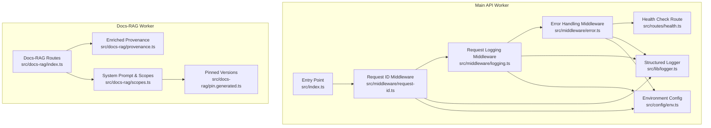
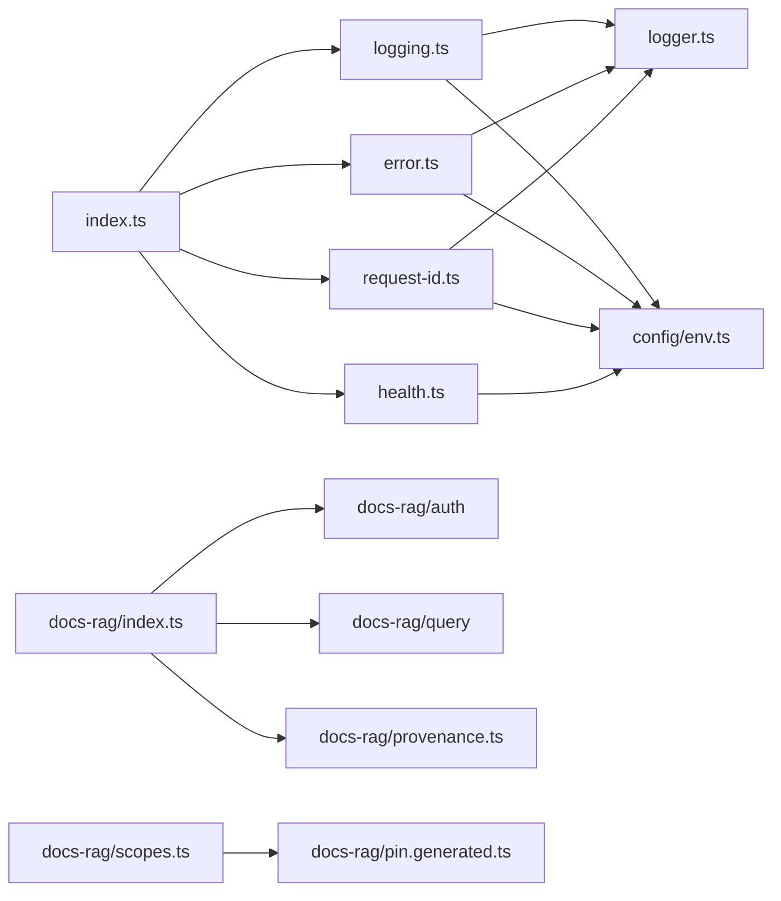

# Monitoring and Observability

<cite>
**Referenced Files in This Document**
- [index.ts](file://src/index.ts)
- [logger.ts](file://src/lib/logger.ts)
- [logging.ts](file://src/middleware/logging.ts)
- [error.ts](file://src/middleware/error.ts)
- [request-id.ts](file://src/middleware/request-id.ts)
- [health.ts](file://src/routes/health.ts)
- [env.ts](file://src/config/env.ts)
- [env.ts](file://src/types/env.ts)
- [wrangler.jsonc](file://wrangler.jsonc)
- [docs-rag index.ts](file://src/docs-rag/index.ts)
- [docs-rag provenance.ts](file://src/docs-rag/provenance.ts)
- [docs-rag scopes.ts](file://src/docs-rag/scopes.ts)
- [docs-rag pin.generated.ts](file://src/docs-rag/pin.generated.ts)
- [gen-docs-rag-pin.mjs](file://scripts/gen-docs-rag-pin.mjs)
</cite>

## Update Summary
**Changes Made**
- Added a Docs-RAG observability section covering its health endpoint, structured search/ask responses, rate-limit error telemetry, and enriched first-party provenance fields.
- Updated the architecture diagram to include the Docs-RAG Worker alongside the main API.
- Added guidance for monitoring pinned dependency versions via `PIN_SENTENCE` and validating that the generated pin stays in sync with the Trackdub runtime manifest.
- Added provenance-aware troubleshooting for search results and answer metadata.

## Table of Contents
1. [Introduction](#introduction)
2. [Project Structure](#project-structure)
3. [Core Components](#core-components)
4. [Architecture Overview](#architecture-overview)
5. [Detailed Component Analysis](#detailed-component-analysis)
6. [Docs-RAG Observability](#docs-rag-observability)
7. [Dependency Analysis](#dependency-analysis)
8. [Performance Considerations](#performance-considerations)
9. [Troubleshooting Guide](#troubleshooting-guide)
10. [Conclusion](#conclusion)
11. [Appendices](#appendices)

## Introduction
This document provides comprehensive monitoring and observability guidance for the TrackDub API running on Cloudflare Workers. It covers structured logging, log levels, formatting standards, request tracing across middleware, error tracking, performance monitoring, custom metrics collection, alerting strategies, health checks, log aggregation, retention policies, debugging production issues, and the Docs-RAG search/ask endpoints with their enriched provenance metadata. The goal is to make the system observable, reliable, and easy to troubleshoot in production environments.

## Project Structure
The monitoring and observability features are implemented through a combination of:
- A centralized logger utility for structured logs
- Middleware that instruments requests with IDs, timing, and error handling
- A health check route for liveness/readiness probes
- Environment configuration for runtime settings
- Wrangler configuration for Cloudflare Workers deployment and analytics
- The Docs-RAG Worker exposing `/health`, `/v1/search`, `/v1/ask`, and MCP routes with rate limiting, structured error responses, and enriched first-party provenance on search hits



**Diagram sources**
- [index.ts](file://src/index.ts)
- [logging.ts](file://src/middleware/logging.ts)
- [error.ts](file://src/middleware/error.ts)
- [request-id.ts](file://src/middleware/request-id.ts)
- [health.ts](file://src/routes/health.ts)
- [logger.ts](file://src/lib/logger.ts)
- [env.ts](file://src/config/env.ts)
- [docs-rag index.ts](file://src/docs-rag/index.ts)
- [docs-rag provenance.ts](file://src/docs-rag/provenance.ts)
- [docs-rag scopes.ts](file://src/docs-rag/scopes.ts)
- [docs-rag pin.generated.ts](file://src/docs-rag/pin.generated.ts)

**Section sources**
- [index.ts](file://src/index.ts)
- [logging.ts](file://src/middleware/logging.ts)
- [error.ts](file://src/middleware/error.ts)
- [request-id.ts](file://src/middleware/request-id.ts)
- [health.ts](file://src/routes/health.ts)
- [logger.ts](file://src/lib/logger.ts)
- [env.ts](file://src/config/env.ts)
- [docs-rag index.ts](file://src/docs-rag/index.ts)
- [docs-rag provenance.ts](file://src/docs-rag/provenance.ts)
- [docs-rag scopes.ts](file://src/docs-rag/scopes.ts)
- [docs-rag pin.generated.ts](file://src/docs-rag/pin.generated.ts)

## Core Components
- Structured Logger: Provides consistent JSON-formatted logs with fields such as timestamp, level, message, and contextual metadata (e.g., request ID).
- Request Logging Middleware: Captures incoming requests, measures latency, and emits structured logs at appropriate levels.
- Error Handling Middleware: Normalizes errors into structured logs and responses, ensuring consistent error telemetry.
- Request ID Middleware: Generates or propagates a unique request identifier to correlate logs across layers.
- Health Check Route: Exposes endpoints for liveness and readiness checks used by orchestrators and external monitors.
- Environment Configuration: Centralizes environment variables controlling log levels, feature flags, and service behavior.

Key responsibilities:
- Ensure every request produces a traceable, structured log entry.
- Standardize error representation and severity classification.
- Provide stable health endpoints for automated monitoring.
- Keep configuration simple and secure via environment variables.

**Section sources**
- [logger.ts](file://src/lib/logger.ts)
- [logging.ts](file://src/middleware/logging.ts)
- [error.ts](file://src/middleware/error.ts)
- [request-id.ts](file://src/middleware/request-id.ts)
- [health.ts](file://src/routes/health.ts)
- [env.ts](file://src/config/env.ts)

## Architecture Overview
The observability architecture follows a layered approach:
- Entry point initializes middleware and routes.
- Request ID middleware assigns a correlation ID to each request.
- Logging middleware records start/end events and duration.
- Error middleware captures exceptions and emits structured error logs.
- Health route exposes status endpoints.
- Logger writes structured logs suitable for aggregation.
- The Docs-RAG Worker adds authenticated search/ask routes, rate limiting, structured error responses, and enriched provenance on search hits.

```mermaid
sequenceDiagram
participant Client as "Client"
 participant MainWorker as "Main API Worker"
 participant DocsRAG as "Docs-RAG Worker"
 participant ReqID as "Request ID Middleware"
 participant LogMW as "Logging Middleware"
 participant ErrMW as "Error Middleware"
 participant Health as "Health Route"
 participant DocsHealth as "Docs-RAG /health"
 participant Logger as "Logger"
 Client->>MainWorker : HTTP Request
 MainWorker->>ReqID : Attach request ID
 ReqID-->>MainWorker : Context with request ID
 MainWorker->>LogMW : Start request lifecycle
 LogMW->>Logger : Emit "request.start"
 MainWorker->>ErrMW : Invoke handler
 alt Success
  ErrMW-->>LogMW : Response OK
  LogMW->>Logger : Emit "request.end" with duration
  LogMW-->>Client : 2xx Response
 else Error
  ErrMW->>Logger : Emit "error" with details
  ErrMW-->>LogMW : Error response
  LogMW->>Logger : Emit "request.end" with error flag
  LogMW-->>Client : 4xx/5xx Response
 end
 Client->>DocsRAG : GET /health or POST /v1/search or /v1/ask
 DocsRAG-->>Client : Health object or structured search/ask result
 Note over DocsRAG : Enriches first-party hit provenance; returns structured error responses for upstream rate limits and failures
```

**Diagram sources**
- [index.ts](file://src/index.ts)
- [request-id.ts](file://src/middleware/request-id.ts)
- [logging.ts](file://src/middleware/logging.ts)
- [error.ts](file://src/middleware/error.ts)
- [health.ts](file://src/routes/health.ts)
- [logger.ts](file://src/lib/logger.ts)
- [docs-rag index.ts](file://src/docs-rag/index.ts)
- [docs-rag provenance.ts](file://src/docs-rag/provenance.ts)

## Detailed Component Analysis

### Structured Logger
- Purpose: Centralized logging utility producing consistent JSON logs with fields like timestamp, level, message, and context.
- Features:
  - Log levels: debug, info, warn, error.
  - Context enrichment: request ID, route, method, status code where available.
  - Output format: JSON lines suitable for log aggregation pipelines.
- Usage patterns:
  - Emit request lifecycle events from middleware.
  - Emit business KPIs via dedicated log entries tagged with event names.
  - Avoid sensitive data in logs; redact tokens and PII.

Best practices:
- Use structured fields instead of freeform strings.
- Include correlation IDs for cross-layer tracing.
- Keep messages concise; attach detailed context as fields.

**Section sources**
- [logger.ts](file://src/lib/logger.ts)

### Request ID Middleware
- Purpose: Generate or propagate a unique request ID to correlate logs and traces.
- Behavior:
  - If absent, generate a UUID-like ID.
  - Attach to request context for downstream use.
  - Propagate via headers when forwarding requests.

Operational impact:
- Enables log correlation across middleware and services.
- Facilitates distributed tracing when integrated with external systems.

**Section sources**
- [request-id.ts](file://src/middleware/request-id.ts)

### Logging Middleware
- Purpose: Capture request start/end events, measure latency, and emit structured logs.
- Responsibilities:
  - Record start time and initial context.
  - Measure duration and status code.
  - Emit standardized log entries for successful and failed requests.
  - Respect log level configuration.

Metrics derived:
- Request rate per route.
- Latency percentiles (p50, p95, p99).
- Error rates by route and status code.

**Section sources**
- [logging.ts](file://src/middleware/logging.ts)

### Error Handling Middleware
- Purpose: Normalize errors into structured logs and responses.
- Responsibilities:
  - Catch unhandled exceptions.
  - Classify severity based on error type and status.
  - Emit structured error logs with stack traces only when safe.
  - Return consistent error responses.

Security considerations:
- Do not expose internal stack traces to clients.
- Redact secrets and sensitive information before logging.

**Section sources**
- [error.ts](file://src/middleware/error.ts)

### Health Check Route
- Purpose: Provide liveness and readiness endpoints for orchestration and monitoring.
- Endpoints:
  - Liveness: Quick check that the worker is alive.
  - Readiness: Verify dependencies (e.g., database connectivity) if applicable.
- Responses:
  - 200 OK when healthy.
  - 503 Service Unavailable when unhealthy.

Integration:
- Used by load balancers, CI/CD pipelines, and alerting systems.

**Section sources**
- [health.ts](file://src/routes/health.ts)

### Environment Configuration
- Purpose: Centralize environment variables for runtime behavior.
- Key variables:
  - LOG_LEVEL: Controls verbosity (debug, info, warn, error).
  - CF_API_TOKEN: For Cloudflare API interactions if needed.
  - Feature flags: Enable/disable optional observability features.
- Validation:
  - Enforce required variables at startup.
  - Provide defaults for non-critical settings.

**Section sources**
- [env.ts](file://src/config/env.ts)
- [env.ts](file://src/types/env.ts)

## Docs-RAG Observability
The Docs-RAG Worker has its own observability surface around search, ask, and MCP operations. Its behavior affects what consumers see in answers and response metadata, especially around dependency pins and provenance.

### Health Endpoint
- Path: `GET /health`
- Returns:
  - `ok`: boolean indicating whether the route responds.
  - `instance`: configured AI Search instance identifier.
  - `model`: configured model name.
  - `scopes`: list of supported documentation scopes.
- Monitoring use:
  - Liveness probe for the Docs-RAG Worker.
  - Drift detection for configured instance/model values.
  - Scope inventory validation during deployment tests.

**Section sources**
- [docs-rag index.ts](file://src/docs-rag/index.ts)

### Search and Ask Endpoints
- Paths:
  - `POST /v1/search`
  - `POST /v1/ask`
- Authentication: Bearer token validated through the Docs-RAG auth layer.
- Rate limiting:
  - Burst and steady limiters apply to both routes.
  - The `/v1/ask` route additionally enforces an expensive `ask` limiter when configured.
- Response structure:
  - Successful calls return structured objects including `scope`, `matchMode`, and `hits`.
  - Search and ask responses are wrapped with `withProvenance`, which enriches first-party hits with repo, local path, synced commit, dirty state, and sync timestamp.
- Error responses:
  - Upstream rate limits map to `429` with `{ error: "rate_limited", limiter: "upstream", retry_after_seconds: 10 }` and a `Retry-After: 10` header.
  - Other failures map to `503` with `{ error: "search_failed" | "ask_failed", message }`.

Observability signals:
- Monitor 429 vs 503 ratios to distinguish client-side rate limiting from upstream failures.
- Inspect `hit.key` and enriched provenance fields to determine whether answers come from first-party or vendor content.
- Treat missing or empty provenance fields as expected for vendor and null-key hits.

**Section sources**
- [docs-rag index.ts](file://src/docs-rag/index.ts)
- [docs-rag provenance.ts](file://src/docs-rag/provenance.ts)

### Enriched First-Party Provenance
Provenance enrichment transforms raw search hits into richer metadata:
- `provenanceFor` parses keys matching `first-party/<repo>/<path>` and attaches:
  - `repo`: repository name extracted from the key.
  - `localPath`: path inside the first-party checkout.
  - `syncedCommit`: commit hash from the sync manifest when present.
  - `syncedDirty`: boolean flag when the source tree was dirty at sync time.
  - `syncedAt`: timestamp from the sync manifest when present.
- `withProvenance`:
  - Filters out the internal sync manifest hit (`first-party/_sync.json`).
  - Adds provenance fields only to first-party hits.
  - Leaves vendor and null-key hits unchanged.

Monitoring implications:
- Consumers should expect extra provenance fields only on first-party hits.
- Missing `syncedCommit` does not mean failure; it can occur when no sync manifest exists or the key is not first-party.
- `syncedDirty: true` indicates the corpus was synchronized from a working tree with uncommitted changes.

**Section sources**
- [docs-rag provenance.ts](file://src/docs-rag/provenance.ts)

### System Prompt and Pinned Dependency Versions
The Docs-RAG system prompt is constructed in the scopes module and includes:
- Guidance to prefer first-party documentation over vendor documentation.
- Conflict resolution rules when first-party and vendor pages disagree.
- A requirement to quote version numbers, flags, symbol names, and source keys verbatim.
- A pinned dependency sentence generated from `PIN_SENTENCE`.

The generated pin contains:
- Platform-specific TensorRT-RTX EP ABI versions.
- CUDA variant.
- TensorRT-RTX runtime version.
- A human-readable `PIN_SENTENCE` embedded into the system prompt.

The generator reads the Trackdub runtime manifest and either writes a new `pin.generated.ts` or fails when `--check` detects drift.

Operational checks:
- Validate that `SYSTEM_PROMPT` contains the current `PIN_SENTENCE`.
- Ensure the committed `pin.generated.ts` is regenerated after updating the runtime manifest.
- Alert if the pin text references unexpected or stale versions.

**Section sources**
- [docs-rag scopes.ts](file://src/docs-rag/scopes.ts)
- [docs-rag pin.generated.ts](file://src/docs-rag/pin.generated.ts)
- [gen-docs-rag-pin.mjs](file://scripts/gen-docs-rag-pin.mjs)

### Docs-RAG Monitoring Examples
- Health check monitoring:
  - Poll `GET /health` and assert `ok` is true.
  - Record `instance`, `model`, and `scopes` as deployment metadata.
- Search/ask success monitoring:
  - Count successful responses per route.
  - Track hit counts and distribution between first-party and vendor keys.
- Error monitoring:
  - Alert on elevated 429 rates to detect upstream rate limiting.
  - Alert on 503 responses to detect search/ask backend failures.
- Provenance validation:
  - Assert that first-party hits include `repo`, `localPath`, and optionally `syncedCommit`.
  - Warn when vendor hits unexpectedly contain first-party provenance fields.
- Pin drift detection:
  - Run the pin generator in `--check` mode as part of CI.
  - Compare `PIN_SENTENCE` against expected versions from the runtime manifest.

[No additional sources needed since this section summarizes documented behavior]

## Dependency Analysis
Observability components interact as follows:
- Entry point wires middleware and routes.
- Request ID middleware depends on logger for context logging.
- Logging middleware depends on logger and env config for level filtering.
- Error middleware depends on logger and env config for safe error serialization.
- Health route may depend on env config for dependency checks.
- Docs-RAG routes depend on auth, rate limiting, query execution, and provenance enrichment.
- Docs-RAG scopes inject the generated pin sentence into the system prompt.



**Diagram sources**
- [index.ts](file://src/index.ts)
- [request-id.ts](file://src/middleware/request-id.ts)
- [logging.ts](file://src/middleware/logging.ts)
- [error.ts](file://src/middleware/error.ts)
- [health.ts](file://src/routes/health.ts)
- [logger.ts](file://src/lib/logger.ts)
- [env.ts](file://src/config/env.ts)
- [docs-rag index.ts](file://src/docs-rag/index.ts)
- [docs-rag provenance.ts](file://src/docs-rag/provenance.ts)
- [docs-rag scopes.ts](file://src/docs-rag/scopes.ts)
- [docs-rag pin.generated.ts](file://src/docs-rag/pin.generated.ts)

**Section sources**
- [index.ts](file://src/index.ts)
- [request-id.ts](file://src/middleware/request-id.ts)
- [logging.ts](file://src/middleware/logging.ts)
- [error.ts](file://src/middleware/error.ts)
- [health.ts](file://src/routes/health.ts)
- [logger.ts](file://src/lib/logger.ts)
- [env.ts](file://src/config/env.ts)
- [docs-rag index.ts](file://src/docs-rag/index.ts)
- [docs-rag provenance.ts](file://src/docs-rag/provenance.ts)
- [docs-rag scopes.ts](file://src/docs-rag/scopes.ts)
- [docs-rag pin.generated.ts](file://src/docs-rag/pin.generated.ts)

## Performance Considerations
- Minimize log volume:
  - Set appropriate LOG_LEVEL for production (info or warn).
  - Avoid logging large payloads; log identifiers and summaries.
- Efficient timing:
  - Use high-resolution timers for latency measurement.
  - Compute percentiles in aggregation pipelines rather than in-worker.
- Reduce overhead:
  - Defer expensive operations until necessary.
  - Batch logs if supported by the aggregation pipeline.
- Cache-friendly health checks:
  - Keep liveness checks lightweight.
  - Make readiness checks idempotent and fast.
- Docs-RAG-specific considerations:
  - Treat `/v1/ask` as more expensive than `/v1/search`; monitor its separate rate limiter.
  - Provenance enrichment adds minimal per-hit processing but depends on reading the sync manifest cache.
  - Keep R2 access to the sync manifest within its TTL window to avoid unnecessary reads.

[No sources needed since this section provides general guidance]

## Troubleshooting Guide
Common issues and resolutions:
- Missing request IDs:
  - Ensure request ID middleware runs before other middleware.
  - Validate header propagation when calling downstream services.
- Excessive logs:
  - Adjust LOG_LEVEL and filter noisy routes.
  - Add sampling for high-volume events.
- Errors not captured:
  - Confirm error middleware wraps all handlers.
  - Check that async errors are properly caught and logged.
- Health checks failing:
  - Verify dependency availability and timeouts.
  - Inspect readiness logic for external services.
- Docs-RAG 429 responses:
  - Indicates upstream rate limiting; inspect `retry_after_seconds` and back off accordingly.
- Docs-RAG 503 responses:
  - Indicates search or ask failure; inspect the returned `message` field.
- Unexpected provenance fields:
  - Only first-party hits should receive `repo`, `localPath`, `syncedCommit`, `syncedDirty`, and `syncedAt`.
  - Vendor and null-key hits must remain unchanged.
- Stale dependency pin:
  - Regenerate `pin.generated.ts` using the pin generator.
  - Verify `SYSTEM_PROMPT` contains the current `PIN_SENTENCE` and does not reference old versions.

Debugging steps:
- Correlate logs using request ID.
- Reproduce issues locally with elevated LOG_LEVEL.
- Inspect error logs for stack traces and context fields.
- Use Cloudflare Workers Analytics for request counts and error rates.
- For Docs-RAG, inspect response shapes for `error`, `scope`, `matchMode`, `hits`, and provenance fields.
- Validate the pin generator output against the Trackdub runtime manifest.

**Section sources**
- [request-id.ts](file://src/middleware/request-id.ts)
- [logging.ts](file://src/middleware/logging.ts)
- [error.ts](file://src/middleware/error.ts)
- [health.ts](file://src/routes/health.ts)
- [docs-rag index.ts](file://src/docs-rag/index.ts)
- [docs-rag provenance.ts](file://src/docs-rag/provenance.ts)
- [docs-rag scopes.ts](file://src/docs-rag/scopes.ts)
- [gen-docs-rag-pin.mjs](file://scripts/gen-docs-rag-pin.mjs)

## Conclusion
By implementing structured logging, request tracing, error normalization, health checks, and Docs-RAG-specific telemetry, the TrackDub API achieves robust observability on Cloudflare Workers. Combining these foundations with Cloudflare Analytics, log aggregation, alerting, and pin drift detection maintains high reliability, clear answer provenance, and rapid incident resolution.

## Appendices

### Cloudflare Workers Analytics Setup
- Enable analytics in your project configuration.
- Use built-in metrics for request counts, error rates, and latency distributions.
- Export logs to external systems via Cloudflare’s integrations or workers’ fetch calls.

**Section sources**
- [wrangler.jsonc](file://wrangler.jsonc)

### Custom Metrics Collection
- Emit business KPIs as structured logs with event names and tags.
- Aggregate metrics in your log pipeline to compute rates, totals, and percentiles.
- Example KPIs:
  - Successful translations per minute.
  - Average translation latency.
  - Language distribution.
- Docs-RAG KPIs:
  - Search and ask request rates.
  - 429 vs 503 error ratios.
  - First-party vs vendor hit distribution.
  - Number of hits with enriched provenance.

**Section sources**
- [logger.ts](file://src/lib/logger.ts)
- [logging.ts](file://src/middleware/logging.ts)
- [docs-rag index.ts](file://src/docs-rag/index.ts)
- [docs-rag provenance.ts](file://src/docs-rag/provenance.ts)

### Alerting Strategies
- Define alerts for:
  - Elevated error rates (e.g., >5% 5xx responses).
  - Latency spikes (p95 > threshold).
  - Health check failures.
  - Docs-RAG upstream rate limits exceeding normal baselines.
  - Docs-RAG search/ask failures returning 503.
  - Pin drift detected by the pin generator.
- Integrate with notification channels (Slack, PagerDuty, email).

### Log Aggregation and Retention
- Aggregate JSON logs into a central system (e.g., Cloudflare Logs, third-party SIEM).
- Apply retention policies based on compliance and cost constraints.
- Index key fields (request_id, level, route, status_code) for fast queries.
- For Docs-RAG, consider indexing response-level fields such as `error`, `scope`, and hit provenance fields where supported by the aggregation pipeline.

### Health Check Examples
- Liveness endpoint returns 200 OK when the worker is running.
- Readiness endpoint verifies dependencies and returns 503 if unavailable.
- Docs-RAG `/health` returns instance, model, and scope metadata.
- Use these endpoints in orchestrators and monitoring tools.

**Section sources**
- [health.ts](file://src/routes/health.ts)
- [docs-rag index.ts](file://src/docs-rag/index.ts)