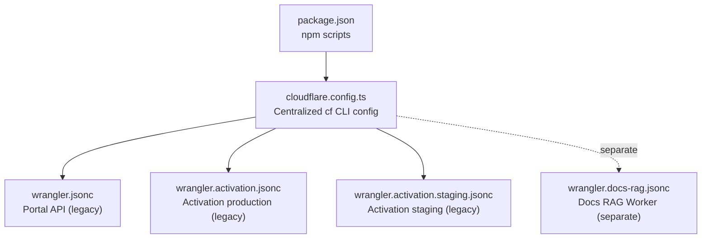
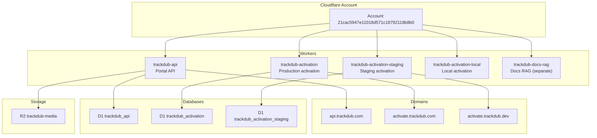
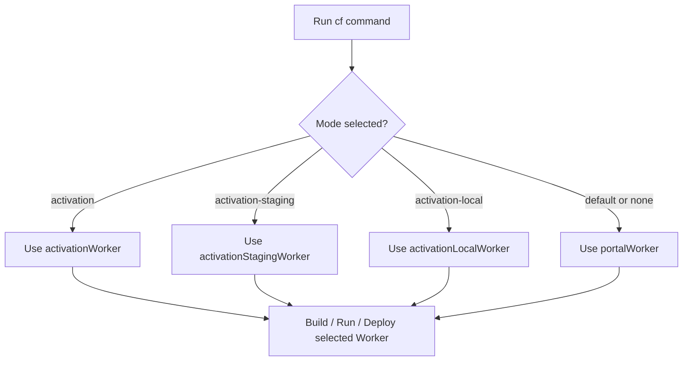
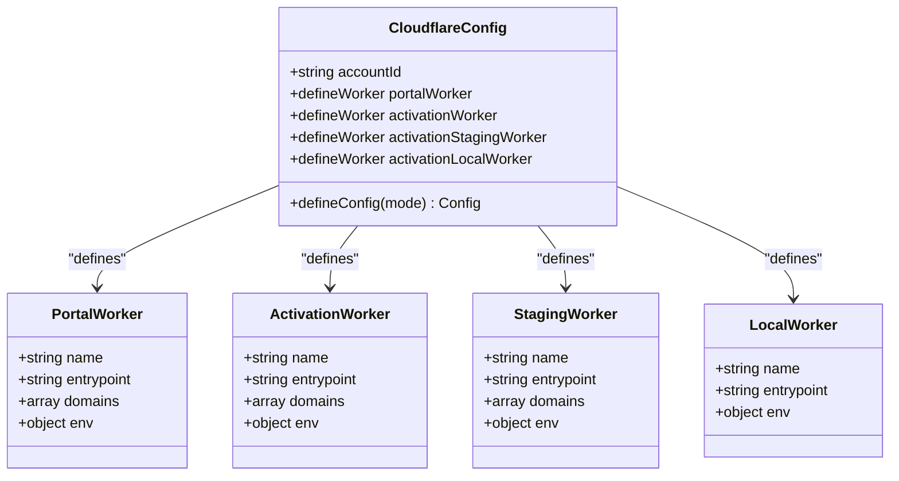
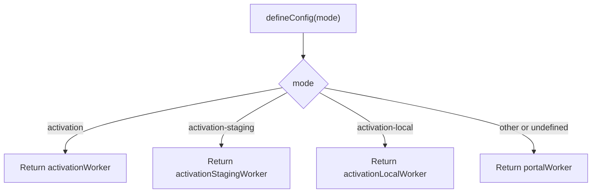
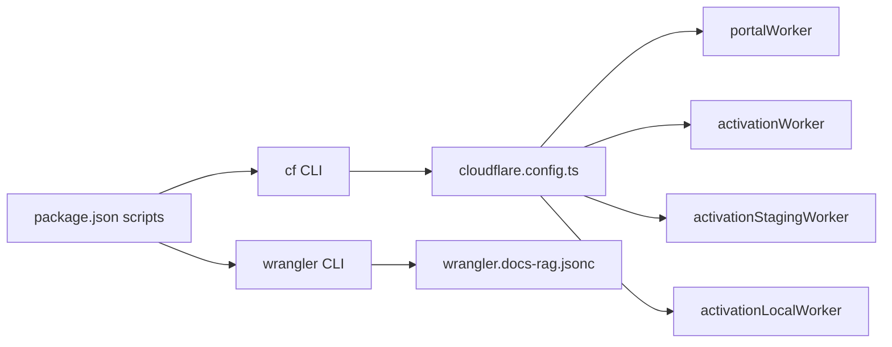

# Multi-Worker Configuration

<cite>
**Referenced Files in This Document**   
- [cloudflare.config.ts](file://cloudflare.config.ts)
- [wrangler.jsonc](file://wrangler.jsonc)
- [wrangler.activation.jsonc](file://wrangler.activation.jsonc)
- [wrangler.activation.staging.jsonc](file://wrangler.activation.staging.jsonc)
- [wrangler.docs-rag.jsonc](file://wrangler.docs-rag.jsonc)
- [package.json](file://package.json)
- [README.md](file://README.md)
</cite>

## Table of Contents
1. [Introduction](#introduction)
2. [Project Structure](#project-structure)
3. [Core Components](#core-components)
4. [Architecture Overview](#architecture-overview)
5. [Detailed Component Analysis](#detailed-component-analysis)
6. [Dependency Analysis](#dependency-analysis)
7. [Performance Considerations](#performance-considerations)
8. [Troubleshooting Guide](#troubleshooting-guide)
9. [Conclusion](#conclusion)

## Introduction
This document explains the new centralized Cloudflare configuration for the Trackdub API repository. A single `cloudflare.config.ts` file now defines four Workers using the `cf` CLI’s `defineConfig`/`defineWorker` pattern and selects which Worker to build, run, or deploy through mode-based selection. The legacy per-Worker Wrangler JSON files remain as supplementary configurations, while the docs-rag Worker is intentionally managed separately with its own `wrangler.docs-rag.jsonc`.

The four Workers are:
- Portal API (`trackdub-api`) — default mode.
- Production activation (`trackdub-activation`).
- Staging activation (`trackdub-activation-staging`).
- Local activation (`trackdub-activation-local`).

**Section sources**
- [cloudflare.config.ts:1-142](file://cloudflare.config.ts#L1-L142)
- [README.md:1-20](file://README.md#L1-L20)

## Project Structure
At the top level, the repository keeps a single Cloudflare configuration file alongside older-style Wrangler configuration files and npm scripts that drive the `cf` CLI.

**Diagram sources**
- [cloudflare.config.ts:1-142](file://cloudflare.config.ts#L1-L142)
- [wrangler.jsonc:1-40](file://wrangler.jsonc#L1-L40)
- [wrangler.activation.jsonc:1-36](file://wrangler.activation.jsonc#L1-L36)
- [wrangler.activation.staging.jsonc:1-35](file://wrangler.activation.staging.jsonc#L1-L35)
- [wrangler.docs-rag.jsonc:1-42](file://wrangler.docs-rag.jsonc#L1-L42)
- [package.json:6-37](file://package.json#L6-L37)

The project layout under `src/` contains the shared runtime code:
- `src/index.ts` — portal API entry point.
- `src/activation/index.ts` — activation Worker entry point.
- `src/docs-rag/index.ts` — documentation RAG Worker entry point.

The central configuration file references these entry points explicitly; it does not bundle all three workers into one artifact.

**Section sources**
- [cloudflare.config.ts:21-37](file://cloudflare.config.ts#L21-L37)
- [cloudflare.config.ts:39-59](file://cloudflare.config.ts#L39-L59)
- [cloudflare.config.ts:61-84](file://cloudflare.config.ts#L61-L84)
- [cloudflare.config.ts:86-106](file://cloudflare.config.ts#L86-L106)

## Core Components
The central configuration defines four worker objects and one mode-aware root configuration.

| Component | Purpose | Mode | Entrypoint | Domain(s) | Database | Notes |
|---|---|---|---|---|---|---|
| `portalWorker` | Main portal API backend | Default | `src/index.ts` | `api.trackdub.com` | D1 `trackdub_api` | Also binds R2 bucket `MEDIA`; includes version metadata binding. |
| `activationWorker` | Production license activation service | `activation` | `src/activation/index.ts` | `activate.trackdub.com` | D1 `trackdub_activation` | Uses production issuer, audience, and signing key ID. |
| `activationStagingWorker` | Staging license activation service | `activation-staging` | `src/activation/index.ts` | `activate.trackdub.dev` | D1 `trackdub_activation_staging` | Enables dev licenses and uses a separate staging database and key ID. |
| `activationLocalWorker` | Local development activation service | `activation-local` | `src/activation/index.ts` | No custom domain configured | Reuses D1 `trackdub_activation` | Development issuer and audience values; intended for local tooling. |

Key implementation characteristics:
- Each Worker uses `nodejs_compat` compatibility flags and has observability enabled.
- Secrets such as `BETTER_AUTH_SECRET`, `ADMIN_API_TOKEN`, and `SIGNING_KEY` are bound through `bindings.secret()`.
- Public text bindings use `bindings.text()` with environment-specific defaults.
- D1 and R2 bindings are declared centrally rather than duplicated across multiple Wrangler files.
- The root `defineConfig` function switches on `mode` to return exactly one Worker definition.

**Section sources**
- [cloudflare.config.ts:19-106](file://cloudflare.config.ts#L19-L106)
- [cloudflare.config.ts:108-142](file://cloudflare.config.ts#L108-L142)

## Architecture Overview
The multi-worker architecture maps directly to Cloudflare account resources: one account ID, multiple D1 databases, one R2 bucket, and multiple custom domains.

**Diagram sources**
- [cloudflare.config.ts:19-106](file://cloudflare.config.ts#L19-L106)
- [wrangler.docs-rag.jsonc:1-42](file://wrangler.docs-rag.jsonc#L1-L42)

The `cf` CLI determines which Worker to target through the `--mode` flag passed to commands such as `dev`, `build`, or `deploy`. If no activation-related mode is selected, the portal API Worker is used.

**Diagram sources**
- [cloudflare.config.ts:108-142](file://cloudflare.config.ts#L108-L142)

**Section sources**
- [cloudflare.config.ts:108-142](file://cloudflare.config.ts#L108-L142)

## Detailed Component Analysis

### Central Configuration File
`cloudflare.config.ts` is the single source of truth for the four primary Workers. It imports `defineConfig` and `defineWorker` from `cf/config` and exports a factory that receives the active mode.

Important design points:
- `accountId` is defined once and reused by every Worker returned from the configuration.
- Secret-like files such as `.dev.vars` are not read by `cf`; they are still loaded locally by `cf dev`.
- D1 migration directories are not embedded in this file; migrations are applied explicitly with directory flags.
- The comment block documents how to select activation Workers via `--mode activation` or `--mode activation-staging`.

**Diagram sources**
- [cloudflare.config.ts:1-142](file://cloudflare.config.ts#L1-L142)

#### Portal API Worker
The portal API Worker is the default deployment target. It exposes `api.trackdub.com`, binds the main D1 database and the media R2 bucket, and includes version metadata for build identification. Its environment variables include `APP_ENV`, `PORTAL_ORIGIN`, secret bindings, and infrastructure bindings.

Relevant responsibilities:
- Hosting the Hono application for authentication, authorization, health checks, version information, languages, and admin invite endpoints.
- Driving CORS and trusted origins through `PORTAL_ORIGIN`.
- Providing `CF_VERSION_METADATA` so the API can report build identifiers.

**Section sources**
- [cloudflare.config.ts:21-37](file://cloudflare.config.ts#L21-L37)
- [cloudflare.config.ts:39-59](file://cloudflare.config.ts#L39-L59)
- [README.md:21-55](file://README.md#L21-L55)

#### Production Activation Worker
The production activation Worker handles license activation requests against `activate.trackdub.com`. It connects to the production activation D1 database and uses production-specific issuer, audience, and signing key identifiers.

Separation concerns:
- The signing key ID is public metadata about which trust-ring key signed tokens.
- The private signing key itself is supplied as a secret binding.
- It uses a different D1 database from the portal API.

**Section sources**
- [cloudflare.config.ts:39-59](file://cloudflare.config.ts#L39-L59)
- [wrangler.activation.jsonc:1-36](file://wrangler.activation.jsonc#L1-L36)

#### Staging Activation Worker
The staging activation Worker targets `activate.trackdub.dev` and isolates staging state in `trackdub_activation_staging`. It enables development licenses and uses a distinct signing key ID so staging tokens cannot be accepted by the production trust ring.

Security implication emphasized by the legacy Wrangler comment:
- A staging deploy must never mint tokens that production would accept, and vice versa.

**Section sources**
- [cloudflare.config.ts:61-84](file://cloudflare.config.ts#L61-L84)
- [wrangler.activation.staging.jsonc:1-35](file://wrangler.activation.staging.jsonc#L1-L35)

#### Local Activation Worker
The local activation Worker is oriented toward local development. It reuses the production activation D1 database identifier but changes environment values such as `APP_ENV`, issuer, audience, and signing key ID. No custom domain is configured for this Worker, making it suitable for local tooling and tests rather than public traffic.

**Section sources**
- [cloudflare.config.ts:86-106](file://cloudflare.config.ts#L86-L106)

#### Mode Selection
The exported configuration function returns the appropriate Worker based on `mode`:
- `activation` → production activation Worker.
- `activation-staging` → staging activation Worker.
- `activation-local` → local activation Worker.
- Any other value → portal API Worker.

This design keeps the default developer experience focused on the portal API while allowing explicit activation modes for license-related work.

**Diagram sources**
- [cloudflare.config.ts:108-142](file://cloudflare.config.ts#L108-L142)

**Section sources**
- [cloudflare.config.ts:108-142](file://cloudflare.config.ts#L108-L142)

### Legacy Wrangler Configuration Files
The repository still contains several `wrangler.*.jsonc` files. These are useful as reference or for tools that still consume Wrangler configuration, but the central `cloudflare.config.ts` is now the authoritative multi-Worker definition.

| File | Role | Relationship to Central Config |
|---|---|---|
| `wrangler.jsonc` | Legacy portal API configuration | Mirrors the portal API Worker’s name, entrypoint, domain, D1/R2 bindings, and version metadata. |
| `wrangler.activation.jsonc` | Legacy production activation configuration | Mirrors the production activation Worker’s name, entrypoint, domain, vars, and D1 database. |
| `wrangler.activation.staging.jsonc` | Legacy staging activation configuration | Mirrors the staging activation Worker’s name, entrypoint, domain, vars, and D1 database. |
| `wrangler.docs-rag.jsonc` | Separate docs-rag Worker configuration | Not part of the four Workers defined by `cloudflare.config.ts`; managed independently. |

Notable differences:
- The central config uses `cf/config` bindings (`bindings.d1`, `bindings.r2`, `bindings.versionMetadata`, `bindings.secret`, `bindings.text`) instead of Wrangler’s `vars`, `d1_databases`, and `r2_buckets` arrays.
- Migration directories are documented as external to the central config and are applied with explicit directory flags.
- The docs-rag Worker remains on the legacy Wrangler path with its own configuration file.

**Section sources**
- [wrangler.jsonc:1-40](file://wrangler.jsonc#L1-L40)
- [wrangler.activation.jsonc:1-36](file://wrangler.activation.jsonc#L1-L36)
- [wrangler.activation.staging.jsonc:1-35](file://wrangler.activation.staging.jsonc#L1-L35)
- [wrangler.docs-rag.jsonc:1-42](file://wrangler.docs-rag.jsonc#L1-L42)
- [cloudflare.config.ts:5-17](file://cloudflare.config.ts#L5-L17)

### NPM Scripts and CLI Usage
`package.json` provides convenience scripts that wrap the `cf` CLI and Vitest. The relevant scripts demonstrate how mode-based selection is used in practice:

| Script | Command | Purpose |
|---|---|---|
| `dev` | `cf dev` | Develop the default portal API Worker. |
| `build` | `cf build` | Build the default portal API Worker. |
| `deploy` | `cf deploy` | Deploy the default portal API Worker. |
| `dev:activation` | `cf dev --mode activation` | Develop the production activation Worker. |
| `dev:activation:local` | `cf dev --mode activation-local --port 8787` | Develop the local activation Worker. |
| `deploy:activation` | `cf deploy --mode activation` | Deploy the production activation Worker. |
| `deploy:activation:staging` | `cf deploy --mode activation-staging` | Deploy the staging activation Worker. |
| `test:activation` | `vitest run --config vitest.activation.config.ts` | Run activation-specific tests. |
| `dev:docs-rag` | `wrangler dev --config wrangler.docs-rag.jsonc` | Develop the docs-rag Worker using its separate Wrangler config. |
| `deploy:docs-rag` | `wrangler deploy --config wrangler.docs-rag.jsonc` | Deploy the docs-rag Worker using its separate Wrangler config. |

The scripts confirm that activation Workers are developed and deployed through `--mode`, while the docs-rag Worker continues to use `wrangler` directly with its dedicated config file.

**Section sources**
- [package.json:6-37](file://package.json#L6-L37)

## Dependency Analysis
The central configuration introduces a clear separation between:
- **Configuration layer**: `cloudflare.config.ts` defines Workers, bindings, domains, and mode selection.
- **Runtime layer**: `src/index.ts` and `src/activation/index.ts` implement the actual Workers.
- **Tooling layer**: `package.json` scripts invoke `cf` or `wrangler` depending on the target.
- **Legacy layer**: `wrangler.*.jsonc` files retain historical configuration shape and serve as reference or fallback.

**Diagram sources**
- [package.json:6-37](file://package.json#L6-L37)
- [cloudflare.config.ts:1-142](file://cloudflare.config.ts#L1-L142)
- [wrangler.docs-rag.jsonc:1-42](file://wrangler.docs-rag.jsonc#L1-L42)

Coupling observations:
- All four central Workers share the same `cf/config` dependency and Cloudflare account.
- The portal API Worker depends on both D1 and R2.
- Activation Workers depend only on D1 and secrets.
- The docs-rag Worker is decoupled from the central configuration and uses its own Wrangler file, AI binding, R2 corpus bucket, and rate limits.

Potential circular dependencies:
- None appear in the configuration layer. The configuration file declares static definitions and a pure function over `mode`; it does not import application route logic.

**Section sources**
- [cloudflare.config.ts:1-142](file://cloudflare.config.ts#L1-L142)
- [package.json:6-37](file://package.json#L6-L37)
- [wrangler.docs-rag.jsonc:1-42](file://wrangler.docs-rag.jsonc#L1-L42)

## Performance Considerations
From a configuration perspective:
- Each Worker is a separate Cloudflare deployment with its own compatibility date and flags.
- Enabling observability globally allows request-level metrics per Worker.
- Keeping separate D1 databases per environment reduces accidental cross-environment data access.
- Using `workersDev: false` for production-facing Workers prevents accidental exposure through `*.workers.dev`.
- The local activation Worker does not define a custom domain, reducing risk when running locally.

No runtime performance optimizations are implemented in the configuration file itself; those belong to the Worker implementations and their middleware/route layers.

[No sources needed since this section provides general guidance]

## Troubleshooting Guide

### Selecting the Wrong Worker
Symptom: Running `cf dev` or `cf deploy` affects the portal API instead of an activation Worker.

Resolution:
- For production activation: use `--mode activation`.
- For staging activation: use `--mode activation-staging`.
- For local activation: use `--mode activation-local`.

**Section sources**
- [cloudflare.config.ts:108-142](file://cloudflare.config.ts#L108-L142)
- [package.json:17-25](file://package.json#L17-L25)

### Missing or Invalid Bindings
Symptom: Build or runtime errors related to D1, R2, secrets, or version metadata.

Resolution:
- Ensure the correct mode is selected so the expected Worker is evaluated.
- Verify that the referenced D1 database IDs exist in the Cloudflare account.
- Set secrets through `cf` or `wrangler secret put` as required by each Worker.
- Confirm that the R2 bucket exists for the portal API Worker.

**Section sources**
- [cloudflare.config.ts:21-37](file://cloudflare.config.ts#L21-L37)
- [cloudflare.config.ts:39-59](file://cloudflare.config.ts#L39-L59)
- [cloudflare.config.ts:61-84](file://cloudflare.config.ts#L61-L84)

### Migration Confusion
Symptom: Uncertainty about where D1 migrations live or how to apply them.

Resolution:
- The central configuration does not embed migration directories.
- Apply portal API migrations with the `drizzle` directory.
- Apply activation migrations with the `drizzle-activation` directory.
- Use the `cf d1 migrations apply` command with the appropriate database ID and directory flag.

**Section sources**
- [cloudflare.config.ts:5-17](file://cloudflare.config.ts#L5-L17)
- [package.json:11-16](file://package.json#L11-L16)
- [package.json:27-35](file://package.json#L27-L35)

### Docs-RAG Worker Not Affected by Central Config
Symptom: Changes to `cloudflare.config.ts` do not affect the docs-rag Worker.

Resolution:
- The docs-rag Worker is intentionally separate and uses `wrangler.docs-rag.jsonc`.
- Use `dev:docs-rag` and `deploy:docs-rag` scripts, which call `wrangler` with that specific configuration file.

**Section sources**
- [wrangler.docs-rag.jsonc:1-42](file://wrangler.docs-rag.jsonc#L1-L42)
- [package.json:15-16](file://package.json#L15-L16)

## Conclusion
The repository has moved to a centralized `cloudflare.config.ts` that defines the portal API, production activation, staging activation, and local activation Workers through the `cf` CLI’s `defineConfig`/`defineWorker` pattern. Mode-based selection makes it explicit which Worker is built, run, or deployed. Legacy Wrangler JSON files remain as reference artifacts, while the docs-rag Worker stays outside this model and continues to use its own configuration. This approach improves clarity around environments, bindings, domains, and secrets while keeping the default developer workflow simple.

[No sources needed since this section summarizes without analyzing specific files]